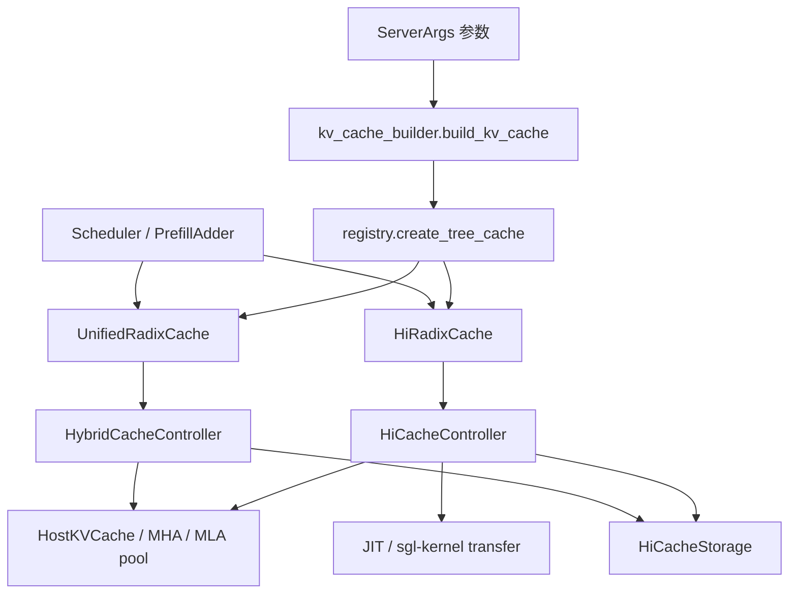

# 00. 如何阅读这套源码

## 0.1 先避免四种常见误读

### 误读一：看到 `TreeNode.value` 就认为它装着 KV

`value` 通常是一个整数 tensor，例如 `[17, 18, 42, 43]`。这些整数是 GPU KV pool 的槽位号。真正的 K/V 张量在 `token_to_kv_pool` 里。

同理，`host_value` 不是 CPU KV 字节，而是 CPU host pool 的槽位号。真正的数据在 `HostKVCache.kv_buffer` 或模型特化的 host buffer 中。

### 误读二：函数返回成功就认为 I/O 完成

HiCache 大量 API 是提交型 API：

- `write()` 返回 host indices：说明 L2 已分配且 D2H 已排队。
- `load()` 返回 device indices：说明 L1 已分配且 H2D 已排队。
- `prefetch()` 返回 operation：说明 L3 查询已进入后台队列。
- `write_storage()` 返回 operation id：说明 L3 写已排队。

真正完成分别由 CUDA event、`ack_write_queue`、`ack_load_queue`、`ack_backup_queue` 或 prefetch operation 的计数确认。

### 误读三：把所有“锁”当互斥锁

源码里有三种不同概念：

| 名称 | 类型 | 保护对象 |
|---|---|---|
| `threading.Lock/RLock` | 真正的线程互斥 | host allocator、metadata cache 等共享 Python 状态。 |
| `lock_ref` | 树节点引用计数 | 防止正在被请求或 I/O 使用的 L1 路径被淘汰。 |
| `host_ref_counter` | host 生命周期计数 | 防止 L2 数据在 L3 I/O 或某些回载组装阶段被释放；经典 H2D 并不把它持有到 final ACK。 |

### 误读四：把“cache hit”看成单一指标

一个请求可能依次出现：

1. L1 命中 1024 token；
2. L2 再命中 2048 token；
3. L3 查询再命中 4096 token；
4. 但 L2 只分配成功 2048 token；
5. L1 回载又因容量不足只恢复 1024 token；
6. 最终真正免算的是 1024 + 2048 + 1024 token。

因此阅读日志和源码时，必须区分“发现命中”“成功读取”“成功回载”“最终复用”。

## 0.2 推荐的源码跟踪方法

每读一个函数，按下面六格记录，不要只逐行翻译：

| 问题 | 示例 |
|---|---|
| 谁调用它？ | Scheduler 在请求入队时调用 `prefetch_from_storage`。 |
| 输入是什么？ | 未命中的 token 后缀、上一页 hash、预留 host indices。 |
| 它分配什么？ | L2 页槽、L1 页槽、operation、引用计数。 |
| 它修改什么状态？ | `ongoing_prefetch`、节点 `host_value`、ACK queue。 |
| 完成条件是什么？ | `completed_tokens` 达标且跨 rank 取 MIN。 |
| 失败时谁清理？ | revoke/release queue 回到调度线程释放。 |

逐函数附录已经自动给出“状态读写”和“直接调用”，可以把它当作这六格的起点。

## 0.3 源码导航地图



建议在编辑器里同时打开四个窗口：

1. `scheduler.py`：看到业务时机；
2. `hiradix_cache.py`：看到树和生命周期决策；
3. `cache_controller.py`：看到异步工作编排；
4. `pool_host/*` 或 `hicache_storage.py`：看到实际数据读写。

不要在一个文件里向下滚动到底。HiCache 的一个动作通常跨这四层完成。

## 0.4 本书采用的“控制面 / 数据面”划分

### 控制面

控制面回答“哪些 token 在哪里、是否可用、谁正在使用”：

- Radix key 与节点关系；
- `value/host_value/hash_value`；
- lock/ref counter；
- ongoing operation 字典；
- queue、event 和 completed token 计数；
- Scheduler 的请求状态与容量预算。

### 数据面

数据面负责搬字节：

- GPU KV tensor；
- host pinned tensor；
- CUDA/HIP/NPU 搬运 kernel；
- storage backend 的 `batch_get_v2/batch_set_v2`；
- 网络、文件或分布式内存系统。

很多 bug 的本质是两者不同步：控制面说“存在”，数据面还没写完；控制面释放了索引，数据面仍在使用；数据面读成功了，但控制面没把节点发布到树上。

## 0.5 需要先认识的 Python 写法

### `@dataclass`

它自动生成构造函数，适合纯数据对象。例如 `PoolTransfer` 把某个 pool 的 host/device indices、keys 和命中策略打包在一起。看到 dataclass 时先看字段，不必寻找手写 `__init__`。

### `@property`

访问形式像字段，实际会调用函数：

```python
node.evicted
```

等价于调用 `TreeNode.evicted` 的 getter。源码中它通常由 `value is None` 推导，不是额外保存的布尔变量。

### 抽象基类 `ABC` / `@abstractmethod`

`HiCacheStorage` 定义“后端必须会什么”，具体后端实现“怎么做”。即便抽象方法里写了 `pass`，调用者仍依赖它的签名和返回语义。

### 类型注解中的 `Optional[T]`

表示值可能为 `None`。在 HiCache 中，`None` 往往是重要状态：

- `value is None`：节点没有 L1 副本；
- `host_value is None`：节点没有 L2 副本；
- allocator 返回 `None`：容量不足；
- storage get 返回 `None`：读取失败或不存在。

### `torch.Tensor` 既可能装数据，也可能装索引

必须看 tensor 的来源和 dtype。`device_indices` 通常是整数索引；`k_buffer/v_buffer` 才是浮点或量化 KV 数据。

### 闭包 / 局部函数

例如 queue drain 内部定义 `_drain_queue`、`_drain_revoke`。局部函数只能在外层函数内调用，用于共享外层变量。附录会把外层完整代码和局部函数分别列出，所以会看到有意的重复。

## 0.6 需要先认识的并发术语

| 术语 | 直观解释 | HiCache 中的例子 |
|---|---|---|
| OS thread | Python 进程中的后台工作线程 | L3 query、L3 read、L3 write。 |
| Queue | 线程之间转交工作/所有权 | `prefetch_queue`、`backup_queue`。 |
| CUDA stream | GPU 上可与默认计算流并发的命令序列 | `write_stream`、`load_stream`。 |
| CUDA event | stream 上的完成标记 | D2H/H2D 完成后 ACK。 |
| `event.query()` | 非阻塞询问是否完成 | scheduler 每轮 polling。 |
| `event.synchronize()` | 阻塞等待完成 | 已确认可收割时确保可见性。 |
| all-reduce MIN | 所有 rank 只采用共同成功部分 | L3 连续命中页数、可消费 ACK 数。 |
| barrier | 所有 rank 在此汇合 | abort/资源回收前确保顺序一致。 |

## 0.7 学习检查点

继续下一章前，应能口头回答：

1. 为什么 `TreeNode.value` 不是 KV 数据？
2. `write()` 返回 host indices 后，为什么节点还不能立即无锁淘汰？
3. `lock_ref`、`host_ref_counter`、`threading.Lock` 分别保护什么？
4. 为什么 L3 命中长度必须是从开头连续的页数？
5. 控制面与数据面不一致会造成哪类错误？

下一章：[大模型推理与 KV Cache 基础](01-foundations.md)。
