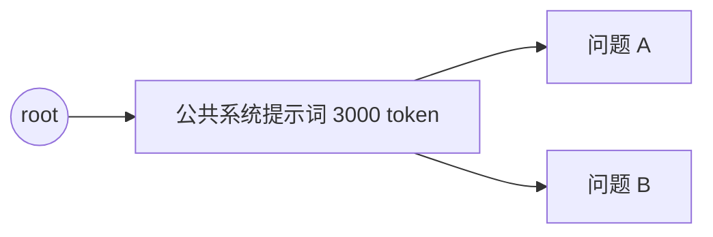
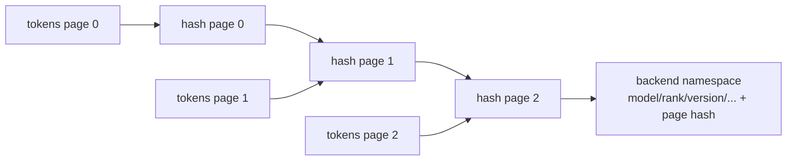

# 01. 大模型推理与 KV Cache 基础

## 1.1 一个 token 是怎样被模型处理的

模型接收的不是字符串，而是一串 token id。为了便于说明，假设：

```text
"北京今天的天气" -> [1012, 845, 73, 991, 204]
```

Transformer 的每一层都会根据当前 token 的隐藏向量计算 Query、Key、Value：

```text
Q = X · Wq
K = X · Wk
V = X · Wv
Attention(Q, K, V) = softmax(QKᵀ / sqrt(d)) · V
```

不需要记住公式细节，只需知道：生成下一个 token 时，当前 Query 需要和此前所有 token 的 Key/Value 做注意力。因此历史 token 的 K/V 会被反复使用。

## 1.2 为什么需要 KV Cache

假设 prompt 有 4 个 token，模型已经算完它们的 K/V。生成第 5 个 token 时：

- 没有 KV Cache：重新计算第 1 到 4 个 token 的 K/V，再处理第 5 个；
- 有 KV Cache：直接读取第 1 到 4 个 token 的 K/V，只为第 5 个 token 计算新 K/V。

生成越长，差距越大。KV Cache 是“把历史计算结果保存起来”，不是保存模型输出文本。

### Prefill 与 Decode

| 阶段 | 做什么 | 典型特征 |
|---|---|---|
| Prefill / Extend | 一次处理 prompt 中尚未缓存的一段 token | token 数多，计算密集。 |
| Decode | 每步生成一个或少量 token | 频繁读取历史 KV，内存带宽敏感。 |

HiCache 主要减少 prefill/extend 的重复计算：如果新请求与旧请求共享长前缀，就直接复用旧前缀的 KV。

## 1.3 从单请求缓存到跨请求前缀缓存

两个请求：

```text
A: [系统提示词 3000 token] + [用户问题 A]
B: [系统提示词 3000 token] + [用户问题 B]
```

前 3000 token 完全相同，因此它们在同一模型、同一 KV 表示下产生相同 K/V。第二个请求可以跳过这 3000 token 的计算。

Radix Cache 用压缩前缀树保存这种共享关系：



真实树不会“一 token 一个节点”。一条边可以保存一段 token，这就是压缩 Radix Tree。

## 1.4 MHA、GQA、MLA 与“一个 token 有多大”

### MHA

MHA 是 Multi-Head Attention，多头注意力。每层有多组 K/V head。一个 token 的 KV 大小可近似写成：

```text
bytes_per_token
  = layer_num × kv_head_num × head_dim × dtype_bytes × 2
```

最后的 `× 2` 是 K 和 V 两份。

例如 32 层、8 个 KV heads、head_dim 128、FP16：

```text
32 × 8 × 128 × 2 × 2 = 131072 bytes ≈ 128 KiB/token
```

4096 token 就约 512 MiB。并发请求越多，L1 很快耗尽。

### GQA/MQA

它们减少 KV head 数，从而降低 KV Cache 大小。对 HiCache 来说仍可使用 MHA 风格的 K/V pool，只是 `head_num` 不同。

### MLA

MLA 使用压缩后的 latent 表示，不一定是传统的独立 K/V 两块。源码因此有 `MLATokenToKVPoolHost` 和 `*_mla` 搬运内核。初学时先掌握 MHA 路径；MLA 的树、生命周期和异步状态机基本相同，差别主要在数据布局和搬运函数。

## 1.5 token、page、slot index 的区别

这是读 HiCache 最重要的一组概念。

### Token id

表示文本内容，例如 `845`。它是 Radix 匹配的内容键。

### Page

HiCache 以固定数量 token 为一页进行对齐、hash、分配和 L3 I/O。假设 `page_size=4`：

```text
token ids: [10, 11, 12, 13 | 14, 15, 16, 17 | 18, 19]
page 0:    [10, 11, 12, 13]
page 1:    [14, 15, 16, 17]
tail:      [18, 19]  <- 不足一页，通常不进入可复用匹配
```

`RadixKey.page_aligned()` 会把长度向下取整到 page 边界。这样 L1、L2、L3 对“可见前缀”使用同一粒度。

### Slot index

slot index 是某一层内存池的位置，与 token id 无关：

```text
token ids       [10, 11, 12, 13]
GPU slot index  [52, 53, 91, 92]
host slot index [ 8,  9, 10, 11]
```

这些位置可以不连续。搬运 kernel 的工作就是根据 `indices_src` 和 `indices_dst` 把离散槽位对应起来。

## 1.6 为什么 L3 使用链式页 hash

如果只对当前页 token 计算 hash，两个不同前缀只要当前页相同就会冲突：

```text
前缀 A + [20, 21, 22, 23]
前缀 B + [20, 21, 22, 23]
```

Transformer 的当前页 KV 依赖此前上下文，因此两页 token 相同不代表 KV 相同。HiCache 使用链式 hash：

```text
h0 = hash(page0_tokens)
h1 = hash(h0, page1_tokens)
h2 = hash(h1, page2_tokens)
```

每页键都包含前序上下文，但这份源码中的 native hash 输入只有 token/bigram 字节与上一页 digest。`RadixKey.extra_key` 会隔离本地 Radix Tree，**不会自动进入 L3 page hash**。模型、rank、LoRA、cache salt 或其他会改变 KV 的语义，必须由 L3 backend namespace 或扩展后的 key protocol 正确隔离。



本地 namespace 与 L3 namespace 的完整区别见 [03b.10](03b-state-and-data-contracts.md#3b10-两套-key-namespace-不要混为一谈)。

## 1.7 L1、L2、L3 各自解决什么问题

| 层级 | 介质 | 优点 | 代价 | 可直接参与模型计算？ |
|---|---|---|---|---|
| L1 | GPU HBM | 延迟最低、带宽最高 | 容量小、昂贵 | 是 |
| L2 | CPU RAM，通常 pinned | 容量较大，H2D/D2H 较快 | 仍受本机容量与 PCIe/NVLink 限制 | 否，需回载 L1 |
| L3 | 文件/远端内存/分布式 KV | 容量最大、可跨实例复用 | 查询与网络/存储延迟最高 | 否，先读 L2 再回载 L1 |

一次 L3 命中的真实路径是：

```text
L3 exists 命中
  -> L2 分配成功
  -> L3 数据完整读入 L2
  -> host Radix 节点发布
  -> L1 分配成功
  -> Scheduler 先把待填充的 indices 加入节点/请求
  -> H2D 提交并由逐层 event 保证读取前完成
  -> 模型跳过对应 token 的计算
```

任何一步失败，最终有效命中都会缩短。

## 1.8 “命中率”至少有五个口径

设请求尝试复用 4096 token：

| 口径 | 分子示例 | 它回答的问题 |
|---|---:|---|
| 本地树命中 | L1 + L2 匹配到的 token | 本机目录里已知多少？ |
| L3 backend hit | `batch_exists` 连续存在的 token | L3 声称有多少？ |
| L3 loaded | 真正读进 L2 的 token | 网络/后端读取成功多少？ |
| L1 loaded back | 真正搬入 GPU 的 token | GPU 容量和 H2D 成功多少？ |
| end-to-end reuse | 最终不需要 prefill 的 token | 业务真正获得多少收益？ |

只看一个 `cache-hit` 百分比，很难判断损失发生在哪一层。

## 1.9 一个具体例子

参数：

```text
page_size = 4
请求长度 = 20 token
L1 已有前 4 token
L2 已有接下来的 8 token
L3 已有再后面的 4 token
最后 4 token 从未缓存
```

理想执行：

1. Radix 匹配返回 L1 4 token，并识别 host-only 节点 8 token；
2. Scheduler 对第 13 到 20 token 发 L3 prefetch；
3. L3 只连续命中第 13 到 16 token，读到 L2；
4. 请求入批前重新匹配，得到 L1=4、L2=12；
5. 为 12 个 L2 token 分配 L1 槽并执行 H2D；
6. 模型只计算最后 4 token；
7. 新算出的 KV 插入树，并按写策略备份到 L2/L3。

如果 L2 只剩 8 个空槽，步骤 3 可能无法为完整 L3 候选分配空间；如果淘汰后仍不足，预取会缩短或跳过。L3 明明有数据，end-to-end 命中仍会下降。

## 1.10 什么时候会重算

以下任一情况会让某段 token 进入 prefill 重算：

- Radix 内容不匹配；
- 不足一页，因 page alignment 不复用；
- L3 从第一个缺页处截断；
- L2 预分配失败或低于预取阈值；
- L3 查询/读取失败、超时或被 best-effort 提前终止；
- 各 TP/PP/CP rank 的共同成功长度更短；
- L1 分配失败，无法把 L2 数据回载；
- 辅助 pool（SWA/Mamba/DSA 等）缺失，使 Unified 路径收缩命中；
- 请求 abort 或调度策略决定不再等待；
- 本地 `extra_key` 不同会拒绝本地树复用；L3 backend namespace 或 page hash 不同会拒绝 L3 复用。

重算通常不是“GPU 等 L3 超时后由某个单独 timer 触发”。更准确地说，Scheduler 在预取停止条件满足后重新匹配；没有被成功发布和回载的后缀自然仍属于 extend input，由正常 prefill 计算。

下一章：[HiCache 总体架构](02-architecture.md)。
