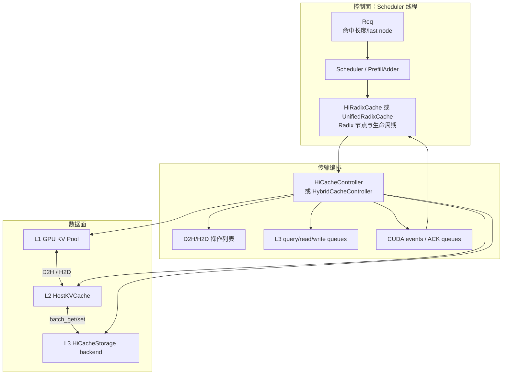
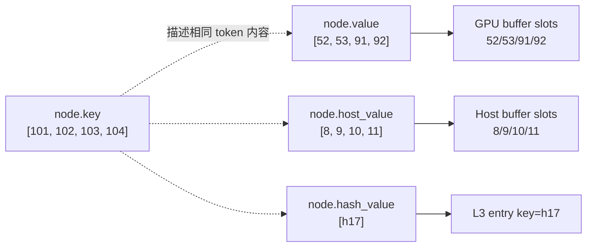
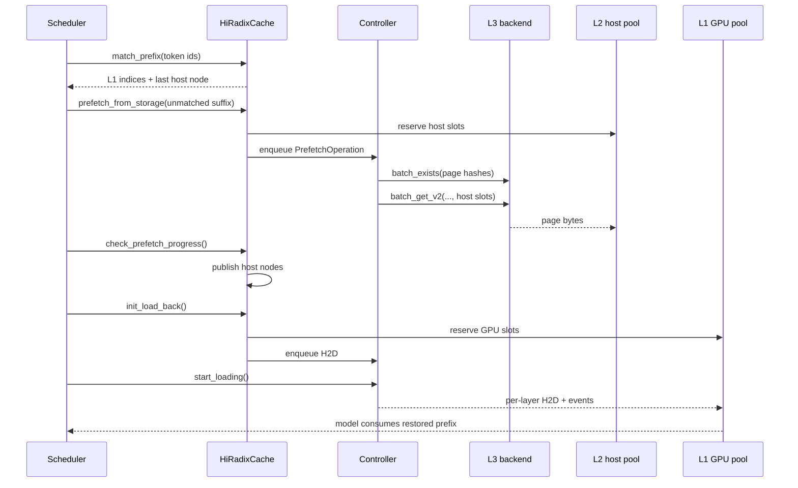
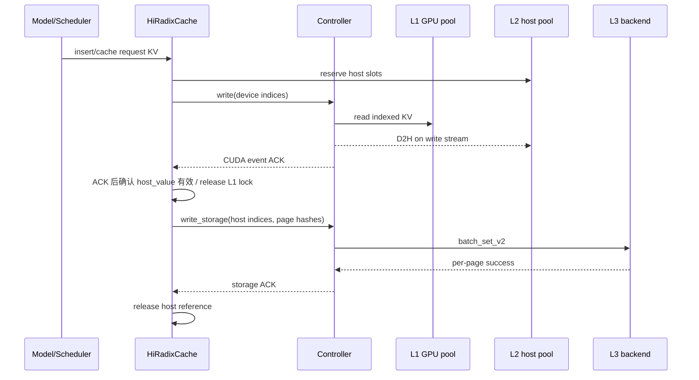
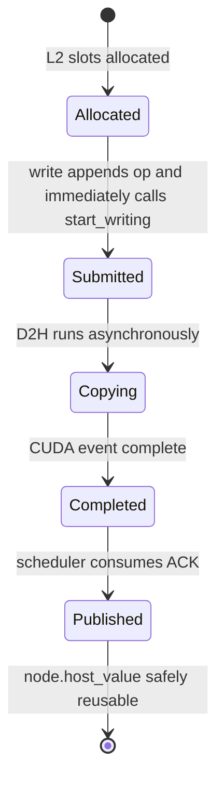

# 02. HiCache 总体架构

## 2.1 一句话架构

HiCache 是一个由 **Radix 元数据目录、三级 KV 数据池、异步传输控制器和 Scheduler 状态机** 共同组成的系统。

它不是“L1 miss 就同步调用 L2，再 miss 就同步调用 L3”的普通缓存库。L3 预取在请求等待阶段异步进行，L2 到 L1 的回载在请求入批时提交，并可与模型逐层计算重叠。

## 2.2 完整组件图



## 2.3 各模块只负责什么

### Scheduler / PrefillAdder

负责业务时机和预算：

- 请求入队时是否发 L3 prefetch；
- 请求是否还需等待 prefetch；
- L1/L2 命中如何减少计算 token；
- L1 容量是否足够回载；
- 何时把 H2D 操作批量启动；
- abort 时通知树清理资源。

它不直接复制 KV 字节。

### RadixCache / HiRadixCache / UnifiedRadixCache

负责目录和生命周期：

- token 前缀匹配、插入、分裂；
- 节点对应哪些 L1/L2 索引；
- 哪些节点可淘汰；
- 哪些节点正在写、读或被请求使用；
- 何时把 controller 的完成结果发布到树；
- 经典单 KV pool 或 Unified 多组件的一致性。

它决定“应该搬什么”，不实现底层 memcpy 或远端协议。

### HiCacheController / HybridCacheController

负责异步编排：

- L1/L2 分配；
- 合并 H2D 操作；D2H 也保留 merge 抽象，但当前经典 `write()` 会立即启动，通常没有跨节点积累；
- 在独立 stream 上发 kernel；
- 建立 per-layer loading event；
- 后台线程执行 L3 exists/read/write；
- 把完成或待释放信息送回调度线程。

它知道 indices 和 operation，不决定 Radix 树结构。

### HostKVCache 与模型特化 pool

负责 L2 物理布局：

- 根据容量预分配 host buffer；
- 管理页槽 free list；
- 将逻辑 token index 映射到 tensor 地址；
- 根据 layout/backend 选择搬运内核；
- 向 L3 后端暴露页 tensor 或零拷贝地址。

### HiCacheStorage

负责 L3 契约：

- 查询最长连续存在页；
- 从 L3 把页填入给定 host indices；
- 从给定 host indices 写出页；
- 多 pool 的共同命中语义；
- 后端生命周期和可选统计。

它不拥有 Radix 节点，也不应自行释放 HiCache 的 host indices。

## 2.4 一个节点同时描述三层位置

经典 `TreeNode` 可以抽象成：

```text
TreeNode
├── key:         这条树边代表哪些 token
├── value:       这些 token 的 L1 slot indices，None 表示无 L1
├── host_value:  这些 token 的 L2 slot indices，None 表示无 L2
├── hash_value:  每页 L3 key
├── lock_ref:    L1 路径保护计数
├── host_ref_counter: L2 生命周期保护计数
├── write_pending: D2H 尚未发布完成
├── hit_count:   选择性写穿策略计数
└── parent/children: Radix 结构
```

典型状态：

| `value` | `host_value` | L3 可能存在 | 含义 |
|---|---|---|---|
| 有 | 无 | 否/未知 | 只有 L1；通常是新算出、还未备份。 |
| 有 | 有 | 否/未知 | 可能是 L1/L2 双副本，也可能仍在 D2H；必须再看 `write_through_pending_id`。 |
| 无 | 有 | 否/未知 | host-only；需要 H2D 后才能计算。 |
| 无 | 无 | 是 | 本地树可能没有该页，需用 hash 查询并预取。 |
| 无 | 无 | 否 | 完全 miss，只能重算。 |

注意：L3 是否存在并不总保存在树节点布尔字段中。正常 L3 预取根据请求 token 和上一页 hash 生成候选 hash，再向 backend 查询。

## 2.5 元数据与真实数据的映射



索引 tensor 本身很小；KV 数据非常大。树操作主要移动/拼接索引，不复制所有 KV 字节。

## 2.6 两条主流水线

### 读流水线



### 写流水线



## 2.7 为什么需要两个控制器实现

经典 `HiCacheController` 假定一次主要传输围绕一个 KV pool 展开。对普通 MHA/MLA 很直观。

混合模型可能要求同一 token 前缀同时恢复多种状态：

- Full KV；
- SWA KV；
- Mamba recurrent state；
- DSA/indexer sidecar；
- draft KV。

`HybridCacheController` 把一个 operation 扩展为多个 `PoolTransfer`，并要求最终可复用长度取所有必要 pool 的共同前缀。这样不会出现 Full KV 已命中、Mamba 状态缺失却错误复用的情况。

## 2.8 生命周期的五个阶段

以 L1 -> L2 写为例：



实现顺序还有一个细节：`Controller.write()` 先提交异步 D2H、登记 ACK，再把 `host_indices` 返回给 Tree；Tree 随后设置 `node.host_value` 和 pending id。Scheduler 不会在这次调用中途收割 ACK，所以控制面仍能按顺序建立 pending 状态，但不能把 `host_value is not None` 当作 DMA 完成条件。

对应读 L3 也有：预留、查询、读取、插入树、回载 L1。源码中 ongoing dict、ref counter 和 release queue 正是在跨越这些阶段时保存所有权。

## 2.9 跨 rank 的“共同成功”原则

Tensor Parallel、Pipeline Parallel 或 Attention Context Parallel 下，不同 rank 保存不同 KV 切片。一个 rank 成功不能代表请求可复用。

HiCache 多处用 MIN 语义：

```text
rank 0 L3 命中 20 pages
rank 1 L3 命中 18 pages
rank 2 L3 命中 20 pages
rank 3 L3 命中 19 pages
=> 共同可用 = 18 pages
```

同样，ACK queue 只能消费所有相关 rank 都完成的共同前缀，否则树状态会分叉，后续 collective 更容易死锁或读到不完整 KV。

## 2.10 经典路径与 Unified 路径

| 项目 | 经典 `HiRadixCache` | `UnifiedRadixCache` |
|---|---|---|
| 主要用途 | 普通 MHA/MLA，以及部分专门接入 | SWA/Mamba/多组件统一管理 |
| 节点数据 | `value/host_value` 直接字段 | `component_data[component_type]` |
| 控制器 | `HiCacheController` | `HybridCacheController` |
| 一次传输 | 主 KV，可附 draft/额外池 | 多个 `PoolTransfer` 的复合操作 |
| 淘汰 | 单一 LRU/leaf 语义 | 每组件 LRU 与 tombstone 协调 |
| 学习顺序 | 先学 | 后学 |

两条路径共享核心原则：页对齐、Radix 前缀、索引与数据分离、异步 ACK、资源引用保护、跨 rank 共同成功。

下一章：[启动、配置与对象装配](03-startup-and-configuration.md)，之后务必补读 [L1 与请求映射](03a-l1-memory-and-request-mapping.md)。
