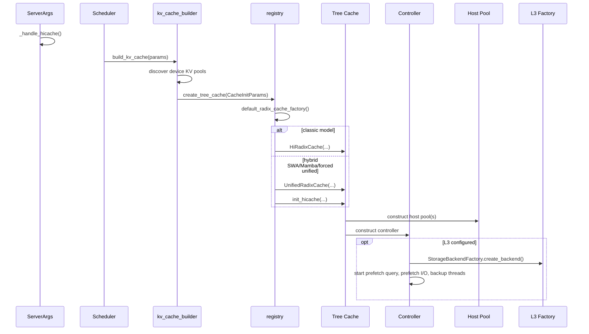
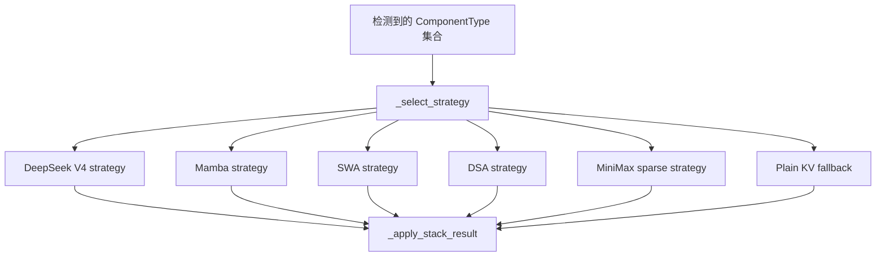

# 03. 启动、配置与对象装配

本章从服务启动开始回答：HiCache 对象是谁创建的，经典/Unified 路径如何选择，L2 容量怎样换算，L3 线程何时启动。

## 3.1 启动调用链



完整函数代码见：

- [A01 Registry](appendix/A01-registry.md)
- [A02 Builder](appendix/A02-kv-cache-builder.md)
- [A02c CacheInitParams](appendix/A02c-cache-init-params.md)
- [A20 参数归一化](appendix/A20-server-args.md)

## 3.2 ServerArgs 中的核心参数

| 参数 | 默认值 | 含义 |
|---|---:|---|
| `enable_hierarchical_cache` | `False` | 是否启用 L2/HiCache。 |
| `hicache_ratio` | `2.0` | L2 token 容量相对 L1 的比例。 |
| `hicache_size` | `0` | 指定 L2 十进制 GB；非零时覆盖 ratio。 |
| `hicache_write_policy` | `write_through` | L1 数据何时备份到 L2。 |
| `hicache_io_backend` | `kernel` | L1/L2 使用 kernel、direct 或 Ascend 路径。 |
| `hicache_mem_layout` | `page_first` | L2 tensor 的维度顺序。 |
| `hicache_storage_backend` | `None` | L3 类型；设置后启用 L3。 |
| `hicache_storage_prefetch_policy` | `timeout` | best-effort、等待完成或超时停止。 |
| `hicache_storage_backend_extra_config` | `None` | 后端和预取的 JSON/配置文件参数。 |

### 参数归一化不是校验小事

`ServerArgs._handle_hicache()` 会主动修正组合：

- `page_first_direct + kernel` 改成 `direct`；
- `page_first + direct` 改成 `page_first_direct`；
- 特定平台/后端不支持某 layout 时改用兼容 layout；
- Mooncake 与 `layer_first` 冲突时，根据 I/O backend 改为页优先布局。

这意味着排障时应看**启动日志中的最终参数**，不能只看命令行原值。

### `backend_extra_config` 中被 HiCache 自己消费的键

`HiRadixCache._parse_storage_backend_extra_config()` 会先从配置中 `pop` 下列键，剩余字典才交给 L3 backend：

| 键 | 默认值 | 作用 |
|---|---:|---|
| `prefetch_threshold` | `256` token | 候选或连续 L3 命中少于该值时不值得预取。 |
| `prefetch_timeout_base` | `2.0` s | timeout policy 的固定等待部分。 |
| `prefetch_timeout_per_ki_token` | `0.1` s/Ki token | 随候选长度增加的等待部分。 |
| `prefetch_timeout_max` | `30.0` s | 线性 timeout 上限。 |
| `hicache_storage_pass_prefix_keys` | `False` | 是否把祖先页 key 列表交给需要它的后端。 |

这些键不会继续出现在 backend 收到的 `extra_config` 中。当前解析器检查类型，但不检查非负性，也不验证 `base <= max`；负 threshold/timeout 或不合理组合可能让 admission/timeout 语义失真，应在部署配置校验和启动测试中主动拒绝。

`HiRadixCache.prefetch_threshold` 保存解析后的配置值；经典 `HiCacheController` 内部则使用 `max(prefetch_threshold, page_size)`。因此配置值小于一页时，Tree 的页对齐已经使候选最少为一页，而 Controller 的 L3 连续命中判定也至少要求一页。排障时应区分这两个同名字段，不能只打印其中一个就推断所有 admission 条件。

另有两个经典路径硬编码阈值：`load_back_threshold=10` token；写穿阈值在 `write_through` 下为 1，在 `write_through_selective` 下为 2。它们不是独立 CLI 参数。

## 3.3 `build_kv_cache()` 做了什么

`build_kv_cache` 是模型 KV pool 和树缓存汇合的入口。可以按四步理解：

1. 从 allocator 取得模型实际使用的 device KV cache；
2. 检测是否有 SWA、Mamba/SSM 或其他混合组件；
3. 把 request-to-token pool、token allocator、TP/PP/CP group、page size 等放进 `CacheInitParams`；
4. 调用 registry 创建具体 tree cache，并返回 `KVCacheBuildResult`。

`maybe_register_hicache_draft()` 处理 speculative decoding 的 draft KV pool。它让 draft pool 使用与主 host pool 对齐的槽位数量，并把它注册给 controller。Draft 传输通常是附加/尽力而为路径，不应改变主 KV 的正确性。

Builder 接到的 `req_to_token_pool` 和 device allocator 在 HiCache 之外就已经创建。它们如何把请求序列映射到 L1 slots，将在 [03a](03a-l1-memory-and-request-mapping.md) 单独展开。

## 3.4 Registry 为什么存在

`registry.py` 把“如何选择实现”从 Scheduler 中抽离。默认工厂大致遵循：

```text
未启用 hierarchical cache
  -> 普通 RadixCache 或 UnifiedRadixCache

启用 hierarchical cache
  + hybrid SSM/SWA/配置要求 Unified
    -> UnifiedRadixCache.init_hicache()
  + 其他普通 MHA/MLA
    -> HiRadixCache
```

Registry 还允许外部注册自定义 Radix cache factory。源码阅读时要意识到：`create_tree_cache()` 返回的是接口类型，运行时具体对象可能不同。

## 3.5 经典 `HiRadixCache.__init__`

初始化按职责可拆成七组，而不是把 130 多行当成一坨：

### 1. 识别 device pool 类型

- `MHATokenToKVPool` -> `get_mha_host_pool_cls(...)`；
- `MLATokenToKVPool` -> `MLATokenToKVPoolHost`；
- DSA/MiniMax sparse -> 交给 hybrid assembler 附件装配；
- 其他类型直接报错，避免布局不匹配后静默读坏数据。

### 2. 保存分布式 group

`tp_group`、`attn_tp_group`、`attn_cp_group`、`pp_group` 服务于不同 collective。不能简单把所有同步都放到默认 world group，否则非 attention rank 或 pipeline stage 可能参与错误的 collective。

### 3. 解析 L3 参数

包括：

- prefetch threshold；
- timeout base 和每 Ki token 增量；
- backend extra config；
- 是否把 prefix keys 传给后端；
- prefetch stop policy。

### 4. 创建 host pool / 特化附件

host pool 在此预分配大块内存。对多 pool 模型，assembler 会创建 `HostPoolGroup` 或 sidecar entry。

### 5. 创建 Controller

Controller 获得 device allocator、host pool、rank 配置、layout/I/O backend、L3 backend 名称和统计开关。

### 6. 初始化 ongoing 状态

主要字典：

| 状态 | key | value 表示什么 |
|---|---|---|
| `ongoing_write_through` | ACK/node id | D2H 完成前被锁住的节点及分裂后发布节点。 |
| `ongoing_load_back` | node id | H2D 完成前的节点、L1 锁和 host 锁。 |
| `ongoing_prefetch` | request id | L3 operation、预留 host indices、anchor 锁。 |
| `ongoing_backup` | storage operation id | L3 写完成前被 host ref 保护的节点。 |
| `prefetch_loaded_tokens_by_reqid` | request id | Scheduler 下一次取走的 L3 成功 token 数。 |

### 7. 注册 shutdown

`atexit.register(self.shutdown)` 用于停止线程和清理资源。运行时 attach/detach 还需走单独生命周期函数，不能只依赖进程退出。

## 3.6 L2 容量到底怎样算

`HostKVCache` 先调用子类的 `get_size_per_token()`。MHA 近似为：

```text
size_per_token = head_dim × head_num × layer_num × dtype_bytes × 2
```

两种配置：

### ratio 模式

```text
host token slots ≈ device pool slots × hicache_ratio
```

### fixed GB 模式

```text
raw_slots = floor(hicache_size_GB × 1_000_000_000 / size_per_token)
page_num = floor(raw_slots / page_size) + 1
host token slots = page_num × page_size
```

随后还会：

- 按 `page_size` 扩到下一页；当前实现使用 `raw_slots // page_size + 1`，即使恰好整页也会再增加一页；
- 根据 PP 各 stage 可用内存取共同安全大小；
- 检查系统可用内存，并保留 `HICACHE_HOST_MEMORY_RESERVE_BYTES`；
- 创建 pinned 或后端专用 allocator 的大 tensor；
- 初始化 `free_slots` 与 `slot_used`。

因此“配置 30G”不等于恰好有 30G 可用 KV，也不等于所有 rank 的 token 槽数都按各自最大值分配。

## 3.7 Controller 初始化后的线程与 stream

经典 Controller 通常包含：

```text
Scheduler thread
├── write_stream: L1 -> L2 D2H
├── load_stream:  L2 -> L1 H2D
├── prefetch query thread: L3 exists
├── prefetch I/O thread:   L3 -> L2 get
└── backup thread:         L2 -> L3 set
```

### 为什么 query 和 read 分两个线程

查询只产生“最长命中到哪里”的元数据，读取才真正占用网络/存储带宽。分开后：

- 可以在查询后跨 TP/CP rank 取共同 MIN；
- 可以裁掉未命中的 host 预留尾部；
- query 不被大数据 read 长时间阻塞；
- read 线程只处理已经确定的连续命中范围。

### 为什么 D2H/H2D 不放这些线程

CUDA 操作本身能在独立 stream 异步执行，不需要另开 Python 线程等待。两个方向当前时机不同：

- H2D：多个请求的 `load()` 先进入 `load_queue`，Scheduler 构建完 batch 后统一调用 `start_loading()`，因此会真实合并并建立 per-layer event；
- D2H：经典 `write()` 追加 `write_queue` 后立即调用 `start_writing()`，因此虽然函数支持 `merge_ops()`，通常一次只搬一个 tree operation。

这一区别会影响性能分析：看到 `write_queue` 和 `merge_ops` 不能直接推断写穿已跨节点批量化。

## 3.8 L3 backend 的创建

`StorageBackendFactory` 保存 `name -> module_path/class_name`，按需 import。创建时传入 `HiCacheStorageConfig`，其中包括：

- TP/PP/attention CP rank 与 size；
- 是否 MLA；
- 是否 page-first；
- 模型名称；
- head splitting 信息；
- backend extra config。

后端创建后，Controller 会注册主 host pool 和可能的附加 pool。零拷贝后端还会依赖 `get_page_buffer_meta()` 给出的地址与字节数。

自研 L3 最容易犯的启动错误是：实例创建成功，但没有正确注册 pool、page size 或 rank namespace。它可能在低并发下偶尔工作，在跨 rank 或多模型时读到错误数据。

## 3.9 Unified 路径的额外装配

`UnifiedRadixCache.init_hicache()` 调用 `attach_hybrid_pool_to_unified_cache()`。后者使用策略注册表匹配模型组件：



`StackBuildResult` 包含 host pool entries、controller、组件附件、sidecar 和计数器。策略按注册顺序选择，测试专门验证优先级和未知组合报错。

## 3.10 启动完成后的对象关系

经典路径可以画成：

```text
Scheduler
└── tree_cache: HiRadixCache
    ├── req_to_token_pool
    ├── token_to_kv_pool_allocator
    │   └── GPU KV pool (L1 bytes)
    ├── root_node -> TreeNode graph (metadata)
    ├── token_to_kv_pool_host (L2 bytes + allocator)
    └── cache_controller
        ├── mem_pool_host -> same host pool
        ├── device allocator -> same L1 allocator
        ├── storage_backend (optional L3)
        ├── streams/events
        └── queues/threads
```

这张关系图解释了为什么 Tree 和 Controller 都能看到 pool：Tree 做决策和提交元数据，Controller 执行分配与搬运；它们共享同一个物理 pool，不是复制了两份。

## 3.11 启动排查清单

1. 最终创建的是 `HiRadixCache` 还是 `UnifiedRadixCache`？
2. `page_size` 在 device pool、host pool、hash 和 L3 是否一致？
3. 最终 `hicache_mem_layout/io_backend` 是否被参数归一化改写？
4. L2 实际 token 槽数和字节数是多少？是否因 PP/rank 取 MIN？
5. host buffer 是否 pinned，外部 allocator 是否成功？
6. L3 backend 的 rank/model namespace 是否唯一且稳定？
7. prefetch query、prefetch I/O、backup 线程是否启动，detach 后是否真正停止？
8. Unified 模型注册了哪些 pool 和 sidecar？
9. draft pool 是否与主 pool 槽位关系正确？
10. prefetch threshold/timeout 是否为非负合理值，且 `base <= max`？
11. 启动 warning 是否表明 JIT 内核回退或 layout 不兼容？

下一章先补齐底层索引：[L1 内存池、请求槽与 KV 物理索引](03a-l1-memory-and-request-mapping.md)。
