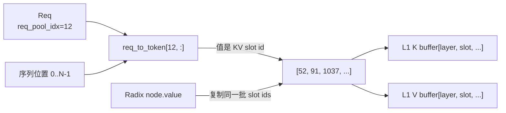
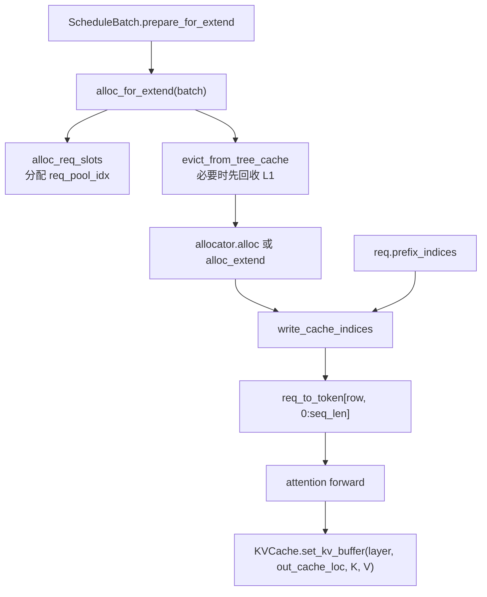

# 03a. L1 内存池、请求槽与 KV 物理索引

前几章说“树节点的 `value` 指向 L1”，但如果不知道这些索引从哪里来，就很难真正读懂请求提交、重复前缀释放和 load-back。本章补齐从 Scheduler 到 GPU KV 字节的底层链路。

完整代码见 [A02d L1 memory pools](appendix/A02d-l1-memory-pools.md)、[A02e allocator contract](appendix/A02e-device-allocator-base.md)、[A02f token allocator](appendix/A02f-token-allocator.md)、[A02g paged allocator](appendix/A02g-paged-allocator.md)、[A02h allocation flow](appendix/A02h-request-allocation-flow.md)，以及混合模型的 [A02i HiSparse](appendix/A02i-hisparse-allocator.md)、[A02j SWA](appendix/A02j-swa-allocator.md)、[A02k Mamba](appendix/A02k-mamba-allocator.md) allocator。

## 3a.1 先分清四种“位置”

一个请求处理到序列位置 6 时，至少存在四套坐标：

```text
req_pool_idx = 12          请求占用 req_to_token 的第 12 行
sequence_pos = 6           这是该请求上下文中的第 7 个 token
kv_slot = 1037             该 token 的 KV 位于 L1 物理槽 1037
layer_id = 9               第 9 层 K/V tensor 中的槽 1037
```

映射关系：



`req_to_token` 不是 KV 数据，也不是 token id。它是一张**请求序列位置到 L1 物理槽位**的索引表。

## 3a.2 `ReqToTokenPool`

普通实现创建：

```text
req_to_token.shape = [max_running_requests + 1, max_context_len]
dtype = int32
device = GPU/NPU/其他计算设备
```

第 0 行是 CUDA Graph padded batch 的哑元行，真实请求从 1 开始。`free_slots` 管理可用请求行。

关键操作：

| 操作 | 做什么 | 不做什么 |
|---|---|---|
| `alloc(reqs)` | 给新请求分配行并写 `req.req_pool_idx`；chunked/已有 committed KV 的请求可复用旧行。 | 不分配 KV 字节槽。 |
| `write((row, positions), slots)` | 把序列位置映射到 L1 slot ids。 | 不复制 K/V。 |
| `free(req)` | 归还请求行并把 `req_pool_idx=None`。 | 不自动释放行中曾指向的 KV slots。 |
| `clear()` | 重置请求行 free list。 | 不替代 tree/allocator 的正常生命周期清理。 |

因此请求结束必须先处理 KV 所有权，再归还请求行。反过来先 `free(req)`，后续代码就失去定位该请求 KV slots 的入口。

## 3a.3 Device KV pool 与 allocator 是两个对象

```text
MHATokenToKVPool / MLATokenToKVPool
  -> 持有真正的 GPU K/V tensor

TokenToKVPoolAllocator / PagedTokenToKVPoolAllocator
  -> 只管理哪些 slot/page id 可分配
  -> get_kvcache() 指回上面的数据池
```

Tree 和 Controller 大多操作 allocator 返回的整数索引；attention backend 最终调用 `set_kv_buffer()` 才把本层 K/V 字节写入数据池。

### 逐 Token 分配：`page_size == 1`

`TokenToKVPoolAllocator` 直接维护 token slots。槽 0 为 padded output 保留，可分配范围从 1 开始。`need_sort=True` 时，刚释放的 `release_pages` 会在空间不足前合并排序，减少频繁排序开销。

### 分页分配：`page_size > 1`

`PagedTokenToKVPoolAllocator` 管理 page ids，但对上层返回展开后的 token slot ids：

```text
page id = 7, page_size = 4
返回 token slots = [28, 29, 30, 31]
```

### 混合模型为什么需要专用 allocator

Full Attention、SWA、HiSparse 和 Mamba 的状态不一定按同一 token/page 语义分配：SWA 需要 full-to-window 映射，HiSparse 还会协调压缩/稀疏 device buffer，Mamba 通常按请求状态槽而不是普通 KV token 槽管理。它们仍遵守“分配返回索引、pool 保存字节、Tree/请求持有所有权”的总原则，但容量口径和释放集合必须看对应专用 allocator，不能直接套普通 `available_size()` 的解释。

`alloc_extend()` 可以先续写已有页的空余部分，再申请完整新页；`alloc_decode()` 只有跨页边界时才消耗新页。`free(indices)` 先做 `indices // page_size` 并去重，因此释放一个页内的若干 token indices，实际归还的是物理页。

这也是为什么 page 模式的释放边界必须经过严格计算：把仍被其他有效 token 使用的同页 index 交给 `free()`，会释放整页。

## 3a.4 Prefill 前怎样分配

普通路径的真实调用链：



`write_cache_indices()` 把一行分成两段：

```text
[0, prefix_len)      <- 已命中的 req.prefix_indices
[prefix_len, seq_len) <- 本轮新分配的 out_cache_loc
```

所以 forward 开始前，索引目录已经完整；新槽中的 K/V 字节要等对应 attention layer 计算后才写好。

## 3a.5 `set_kv_buffer()` 才写真实字节

不同 attention backend 的调用位置不同，但共同语义是：

```text
输入：本层新算出的 cache_k/cache_v + 本轮 out_cache_loc
动作：把每个 token 的 K/V 写到 L1 buffer 的指定 slot
```

MHA 常见物理布局是 NHD/HND/分页变体；MLA 可能只有压缩 latent 与 rope 部分，不一定有传统独立 K/V。`KVWriteLoc` 还可以同时携带 unified pool 的虚拟位置、SWA 物理位置和 full-attention 物理位置。

读 HiCache 时通常不必先掌握所有 attention backend，只需保持这个不变量：**Radix Tree 接管的是已经由 forward 填好的 slot ids，而不是它自己计算 KV。**

## 3a.6 Forward 后怎样交给 Radix Tree

Prefill 结果回到 Scheduler 后：

```text
请求完成   -> release_kv_cache -> tree_cache.cache_finished_req
请求未完成 -> maybe_cache_unfinished_req -> tree_cache.cache_unfinished_req
```

实际入口见 [A19b result commit](appendix/A19b-result-cache-commit.md)。

### 已完成请求

`cache_finished_req()`：

1. 从 `req_to_token[req_pool_idx, :kv_committed_len]` 取 slots；
2. 按页对齐 token key；
3. 把对应 slot ids 复制为 `node.value`；
4. 已经存在于树中的重复前缀 slots 归还 allocator；
5. 未对齐尾部和 speculative over-allocation 由结束清理释放；
6. 最后 `ReqToTokenPool.free(req)` 才归还请求行。

“插入树”本质上是把 L1 slots 的所有权从请求转给共享 Radix 节点。它不复制整份 GPU KV。

### 未完成请求

`cache_unfinished_req()` 插入后会再次 match，并把请求行中的前缀区间重写成树最终拥有的 canonical slots。这样多个请求算出了相同前缀时，后来的请求可释放重复物理页并改指向共享副本。

## 3a.7 三个容易混淆的长度

| 字段 | 精确含义 |
|---|---|
| `kv_allocated_len` | allocator 已为请求保留到哪里；speculative decoding 时可能大于实际接受长度。 |
| `kv_committed_len` | forward 结果中已经确认有效、可提交的 KV 长度。 |
| `cache_protected_len` | 前缀中已被 Radix Tree 接管、不能再按请求私有 KV 释放的长度。 |

`prefix_indices` 也不总等于 `cache_protected_len`。当 `page_size > 1` 时，当前请求可能暂时保留一个未满页尾部供下一轮继续写；这部分可出现在 `prefix_indices`，但尚未形成可共享的页对齐 Radix 节点。

示例：

```text
page_size = 4
当前请求已有 10 token KV
树中稳定共享前缀 = 8

cache_protected_len = 8
prefix_indices 可能包含 10 个 slots
最后 2 个只属于当前请求，下一轮/结束时必须单独处理
```

这正是 `cache_unfinished_req()` 里不能简单以 `len(prefix_indices)` 作为释放起点的原因。

## 3a.8 Decode 怎样延长映射

`ScheduleBatch.prepare_for_decode()` 调 `alloc_for_decode()`：

1. 每请求申请一个新 token slot，或在 page boundary 申请新页；
2. 把新 slot 写入 `req_to_token[req_pool_idx, current_position]`；
3. attention layer 把新 token K/V 写入该 slot；
4. `kv_committed_len/kv_allocated_len` 随实际 decode 进度增长。

内存不足时先从 tree cache 淘汰；仍无法满足则进入请求 retract/OOM 处理。HiCache 的 L2/L3 命中并不会绕过这个 L1 约束，因为 decode attention 最终仍要通过这张映射读取历史 KV。

## 3a.9 L2 load-back 如何接入同一套索引

`HiCacheController.load()` 也调用同一个 device allocator 分配 L1 slots。Tree 会先把返回的 slots 设置到 `node.value`，请求也会把它们拼入 `prefix_indices`，但 H2D 字节复制尚未完成。

安全性来自两层：

- `lock_ref` 防止这些 L1 slots 在 H2D 完成前被淘汰；
- `LayerLoadingEvent` 保证模型读取第 i 层前，该层 host -> device 复制已完成。

所以“映射已经写好”和“对应 KV 字节已经可读”仍是两个时间点。

## 3a.10 这一层的压力与监控

| 资源 | 压力现象 | 适合监控 |
|---|---|---|
| 请求行 | 高并发时无 `req_pool_idx` | free request rows、alloc failure、复用行数量。 |
| L1 token/page | prefill admission 失败、decode retract | free/evictable/protected tokens、申请/成功/失败 token。 |
| 页碎片 | 明明有 token 空间却需新页 | new pages/request、partial-page occupancy。 |
| `req_to_token` 写入 | 大 batch 的索引准备变慢 | write latency、Triton/torch fallback。 |
| KV store kernel | forward 中写缓存耗时 | 每层 store latency、实际 bytes/s。 |
| duplicate prefix | 重复计算后释放很多 slots | inserted prefix、duplicate-freed tokens。 |
| over-allocation | speculative 尾部占用 | allocated minus committed tokens。 |

下一章先把跨模块传递的数据对象集中列清：[状态与数据契约](03b-state-and-data-contracts.md)。
