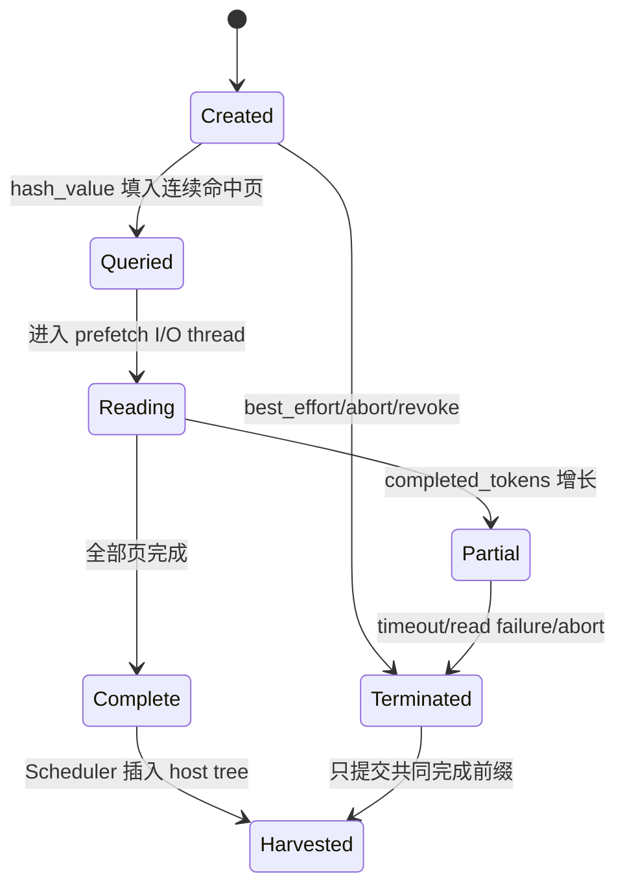
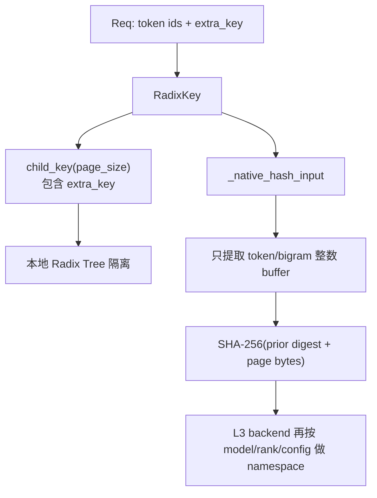

# 03b. 状态对象与跨模块数据契约

HiCache 的复杂性很大一部分不在算法，而在“同一个字段在不同阶段代表什么”。本章把散落在 Tree、Controller、Scheduler 和 Storage 中的小数据对象集中解释，后续读函数时可把它当状态字典。

## 3b.1 `CacheInitParams`：启动时的一次性交接

`build_kv_cache()` 用它把 Scheduler 已创建的资源交给具体 cache factory。完整声明见 [A02c](appendix/A02c-cache-init-params.md)。

| 字段组 | 代表什么 |
|---|---|
| `req_to_token_pool` | 请求行到 L1 slot 的索引矩阵。 |
| `token_to_kv_pool_allocator` | L1 slot/page allocator，并可取得真实 device KV pool。 |
| `page_size` | 树边界、L1/L2 分配和 L3 hash/I/O 的共同粒度。 |
| `tp/attn_tp/attn_cp/pp_*_group` | 各类状态同步应在哪些 rank 间执行。 |
| `eviction_policy` | leaf priority 的计算策略。 |
| `enable_metrics/events/session` | 可观测、路由事件和 session 生命周期附件。 |
| `tree_components` | Unified cache 需要管理的 Full KV/SWA/Mamba 等组件。 |

`cache_ttl_seconds` 当前只出现在 dataclass 声明中，在这份源码快照里没有运行时读取点。它不能被当作“Radix 节点 TTL 已生效”的证据；L3 文件后端的 metadata TTL 是另一套独立机制。

## 3b.2 Prefix Cache 的参数与结果

这些类型定义在 `base_prefix_cache.py`，完整字段和函数见 [A02b](appendix/A02b-prefix-cache-contract.md)。

### `MatchPrefixParams`

```text
key:       要匹配的 RadixKey
cow_mamba: Mamba 是否需要 copy-on-write 处理
req:       某些组件验证需要请求上下文
```

### `InsertParams`

```text
key/value: token 边和对应 L1 indices
mamba_value: recurrent state slot
prev_prefix_len/swa_evicted_seqlen: SWA 特有边界
chunked: 本次是否是中间 chunk
priority: 请求优先级向节点传播
```

### `InsertResult`

`prefix_len` 是新 key 中已经由树拥有的长度，调用者用它释放重复 slots。Unified 路径还会使用 `total_len`、`mamba_exist` 和 `inserted_host_node` 等结果；不能只凭字段名假设每个 cache 实现都会填全部字段。

### `EvictParams/EvictResult`

Full KV、SWA 和 Mamba 的容量单位不同，所以请求和结果分别有 `num_tokens`、`swa_num_tokens`、`mamba_num`。经典 MHA 通常只使用第一项。

### `IncLockRefResult/DecLockRefParams`

锁操作不仅返回 token delta。Unified/SWA 还可能返回 UUID 和 acquire 时的 tombstone 集合，释放时必须原样重放。`to_dec_params()` 就是为了避免调用者手工拼错这组对称状态。

## 3b.3 `MatchResult` 每个字段的准确边界

| 字段 | 含义 |
|---|---|
| `device_indices` | 从 root 开始可直接作为 L1 前缀使用的 slots。 |
| `last_device_node` | 这段连续 L1 前缀的终点。 |
| `last_host_node` | L3 prefetch 用的可靠 host/hash anchor；不一定是 L2 load-back 的最终 anchor。 |
| `best_match_node` | 所有必要组件共同接受的最深节点，L2 load-back 从这里回走。经典路径通常等于 `last_host_node`。 |
| `host_hit_length` | L1 之后需要 H2D 的 Full KV token 数，不包含 `device_indices`。 |
| `swa_host_hit_length` | 需要恢复的 SWA token 数。 |
| `mamba_host_hit_length` | 需要恢复的 Mamba state 数，通常为 0 或 1。 |
| `mamba_branching_seqlen` | Mamba 可安全分支/恢复的页对齐序列边界。 |
| `cache_protected_len` | Tree 已接管的请求前缀长度；未提供时调用者通常取 `len(device_indices)`。 |

两个常见错误：

1. 用 `last_host_node` 代替 Unified 的 `best_match_node`，可能越过某个 auxiliary component 的有效边界；
2. 把 `host_hit_length` 当成本地总命中，它实际只是 L1 之后的 host-only 长度。

## 3b.4 经典 `TreeNode` 的“存在”与“有效”

`backuped` 的实现只是：

```text
host_value is not None
```

它不等待 D2H event。因此要联合 `write_through_pending_id` 判断：

| `value` | `host_value` | pending id | 安全解释 |
|---|---|---|---|
| 有 | 无 | 无 | 只有有效 L1。 |
| 有 | 有 | 有 | L2 slots 已分配并已提交异步 D2H，但 host 字节尚未由 Scheduler ACK 发布。 |
| 有 | 有 | 无 | L1/L2 都可作为已完成副本使用。 |
| 无 | 有 | 无 | host-only，需 load-back 后计算。 |
| 无 | 无 | 无 | 经典树中通常不是可复用普通节点；root/删除中间态另论。 |

当前节点没有 `storage_committed` 字段。`hash_value` 只说明“可用哪些 key 查询 L3”，不证明这些 key 已成功写入。

## 3b.5 `None`、空 tensor 和逻辑 root 不相同

- `value is None`：没有 L1 副本，`evicted=True`；
- `value` 是长度 0 tensor/list：对象存在但不含 token，root 使用这种表示；
- `host_value is None`：没有 L2 slots；
- `hash_value=[]`：没有页 hash，常见于 root 或 query 尚未产生结果；
- `operation.host_indices is None`：某些复合/失败路径表示数据搬运尚未真正建立。

用 `if value:`、`if value is None` 和 `len(value)==0` 得到的语义不同。阅读断言时先确认代码要区分的是“无对象”还是“零长度”。

## 3b.6 L1/L2 operation 对象

### `CacheOperation`

```text
host_indices
device_indices
node_ids
priority
```

它只携带索引，不携带整份 KV。`merge_ops()` 会 concat 两组 indices 并合并 node id。

当前经典 Controller 的两个方向并不完全对称：

- `load()` 只追加 `load_queue`，多个请求可在 Scheduler 调 `start_loading()` 时真实合并；
- `write()` 追加 `write_queue` 后**立即调用 `start_writing()`**，所以经典写路径通常一次只有一个 operation，虽然 `merge_ops()` 仍支持多项。

这一区别既影响源码时序，也影响“小写操作是否真正批量化”的性能判断。

### `HiCacheAck`

```text
start_event
finish_event
node_ids
```

ACK 对象入队只说明 event 已创建并记录，不说明 `finish_event` 已完成。Tree 的 `writing_check/loading_check` 查询并同步后才提交元数据。

## 3b.7 L3 operation 对象

### `StorageOperation`

| 字段 | 阶段含义 |
|---|---|
| `host_indices` | L3 写的源 L2 slots。 |
| `token_ids` | 用于生成页 hash 的逻辑 token 序列。 |
| `hash_value` | 已知页 keys；为空时可在 query/write 路径生成。 |
| `prefix_keys` | 某些后端需要的祖先 key 列表。 |
| `completed_tokens` | Controller 明确认可完整成功的连续 token 数。 |
| `id` | 进程内 operation id，用于 ongoing/ACK 对应。 |

### `PrefetchOperation`

额外保存 `request_id/start_time/_terminated_flag`，并用锁保护 terminate 与 `completed_tokens` 增量。典型状态变化：



`completed_tokens` 必须在页字节写入 L2 后增加；否则它会成为错误的发布屏障。

## 3b.8 Multi-pool 数据契约

`PoolTransfer` 是 Hybrid/Unified 路径的一条 pool 描述：

```text
name
host_indices / device_indices
keys
hit_policy
nodes_to_load
indices_from_pool
```

`indices_from_pool` 表示 sidecar 沿用另一个真实 pool 的位置，并不表示两个 pool 共用同一数据 tensor。`PoolTransferResult` 的 `kv_hit_pages` 是最终主 KV 连续前缀，`extra_pool_hit_pages` 用于记录辅助 pool 的可用页数。

## 3b.9 Req 中的 HiCache 状态

| 字段 | 谁写 | 谁读 |
|---|---|---|
| `req_pool_idx` | `ReqToTokenPool.alloc` | allocation、tree commit、release。 |
| `prefix_indices` | match/load-back/cache_unfinished | batch allocation、attention metadata。 |
| `last_node` | match/cache_unfinished | lock release、下一轮插入。 |
| `last_host_node` | match | L3 prefetch anchor。 |
| `best_match_node` | match | L2 load-back。 |
| `host_hit_length` | match | PrefillAdder 预算与 load-back。 |
| `storage_hit_length` | Scheduler 收割 prefetch | 指标/请求状态，不等于最终 L1 reuse。 |
| `cached_tokens` | batch 结果统计 | 本请求最终计入缓存复用的总 token；用于输出和请求级指标。 |
| `cached_tokens_device/host/storage` | 首个 prefill chunk 的统计路径 | 把有效缓存 token 按本次请求的 L1、L2、L3 归因拆分；这是请求归因，不是 backend 全量 I/O 漏斗。 |
| `_cache_breakdown_computed` | batch 结果统计 | 防止 chunked prefill 在后续 chunk 重复累计来源明细。 |
| `cache_protected_len` | match/cache commit | duplicate/tail 的正确释放边界。 |
| `kv_committed_len` | prepare/forward result | 可交给 tree 的有效长度。 |
| `kv_allocated_len` | allocator/forward | 结束时找 speculative over-allocation。 |
| `extra_key` | Req 初始化 | 本地 Radix 匹配隔离。 |

## 3b.10 两套 key namespace 不要混为一谈

本地树和 L3 目前使用不同的 key 构造链：



源码事实：`_native_hash_input()` 会读取 `raw_token_ids/token_ids/is_bigram`，不会读取 `RadixKey.extra_key`。因此：

- `extra_key`、`cache_salt`、`lora_id` 能隔离本地树；
- 它们**不会自动改变当前 L3 page hash**；
- `HiCacheStorageConfig.model_name`、TP/PP/CP 信息会交给 backend，但是否进入最终 namespace 由后端实现保证；
- 若同一 L3 namespace 中，相同 token 序列在不同 LoRA/salt/其他计算语义下会生成不同 KV，这份源码不能只靠 `extra_key` 防止 L3 错误复用。

这是当前源码边界，不应被文档中的“内容寻址”四个字掩盖。自研 L3 应明确把所有会改变 KV 字节的语义版本纳入 namespace；若需要 per-request `extra_key` 隔离，则还需要扩展传给 L3 的 key/protocol，而不是仅改本地 RadixKey。

## 3b.11 返回值代表哪个完成阶段

| 调用 | 返回时可以确信 | 不能确信 |
|---|---|---|
| `HostKVCache.alloc` | slots 已归调用方。 | slots 中已有正确数据。 |
| `Controller.write` | L2 已分配，D2H 已在 stream 提交，ACK 已登记。 | D2H 已完成或 L3 已写。 |
| `Controller.load` | L1 已分配，operation 已排队。 | H2D 已启动；它要等 `start_loading()`。 |
| `start_loading` | 每层 H2D/event 已提交，返回 producer id。 | 所有层已完成。 |
| `write_storage` | operation 已进入 backup queue。 | backend set 成功。 |
| backend `batch_set=True` | 按契约本批源 buffer 可安全复用且内容已达到承诺可见性。 | HiCache Tree 已额外记录 durability；当前没有该状态。 |

下一章进入真正的元数据算法：[Radix Tree 与节点状态](04-radix-tree.md)。
