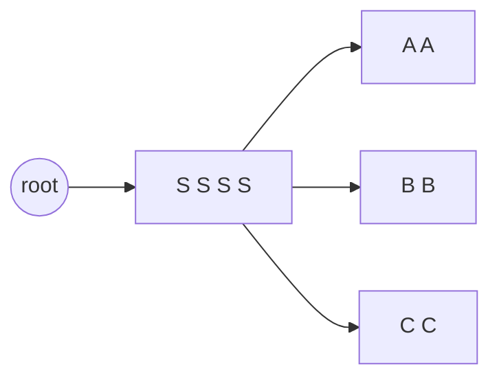
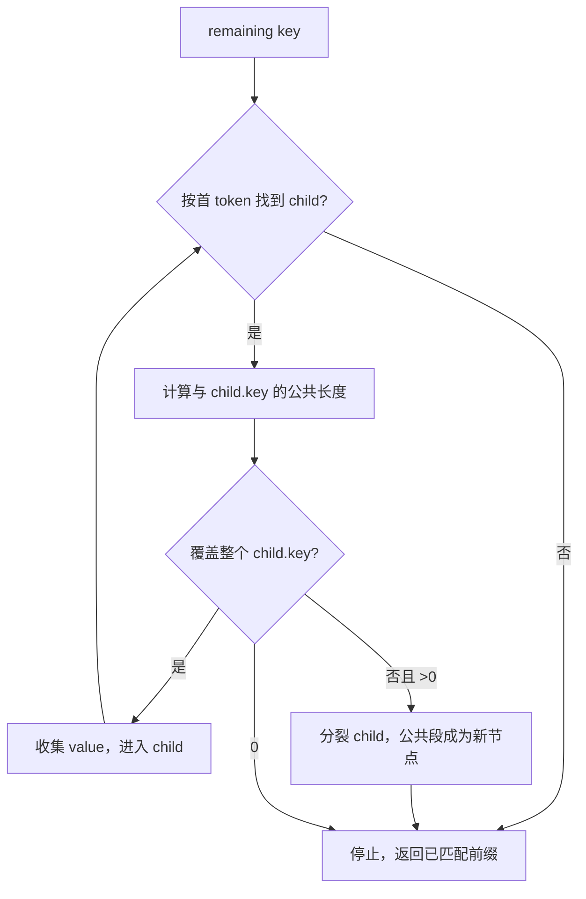
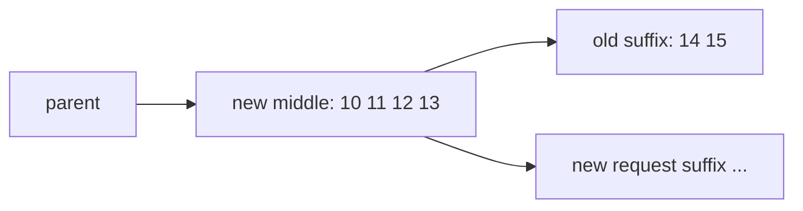

# 04. Radix Tree 与节点状态

完整函数代码见 [A03 基础 RadixCache](appendix/A03-radix-cache.md) 和 [A04 HiRadixCache](appendix/A04-hiradix-cache.md)。本章重点解释算法和不变量。

## 4.1 为什么不是普通字典

如果用“完整 prompt -> KV”字典，下面三个请求会存三份公共系统提示词：

```text
[S S S S A A]
[S S S S B B]
[S S S S C C]
```

Radix Tree 把公共前缀只存一次：



树的一条边保存一段 token，而不是单个 token。这样节点数和遍历开销更小，但匹配中间位置时需要“分裂节点”。

## 4.2 `RadixKey`：不只是 token list

`RadixKey` 包装四类信息：

- `token_ids`：原始 token 序列或 tensor；
- `extra_key`：本地 Radix namespace，必须相容才能匹配；当前不会自动进入 L3 page hash；
- `is_bigram`：EAGLE 等场景下用相邻 token 对作为逻辑元素；
- `limit`：让一个 key 在不复制底层 array 的情况下表现为“只看到前 N 个原始 token”；普通 `__getitem__` 切片当前仍会创建新的 array 片段。

### `__len__` 为什么可能不等于原始 token 数

普通模式：逻辑长度等于 token 数。

Bigram 模式可把相邻 pair 视为匹配元素。源码用 `raw_len` 与逻辑 `len` 区分，切片时必须保留共享边界。读涉及 EAGLE 的代码时，不能假定 `key[:n]` 总是简单取前 n 个原始 token。

### `page_aligned()`

它把逻辑长度向下对齐：

```text
aligned_len = floor(len(key) / page_size) * page_size
```

不足一页的尾部不作为稳定缓存前缀。这能保证：

- 节点边界与 allocator 页一致；
- `hash_value` 一项对应一页；
- L3 一次读写完整页；
- 跨 rank 共同长度不会落在半页。

### `_check_compatible()`

`_check_compatible()` 当前显式检查两个 key 的 `extra_key`。Bigram 语义一致性由上层调用链保证，并未在这个函数中再次断言；阅读或扩展调用者时应把它当作额外不变量。如果本地 namespace 不同仍匹配，会造成“token 相同但模型上下文不同”的错误复用，属于数据正确性问题。

但这项检查只覆盖本地树。`_native_hash_input()` 不读取 `extra_key`，所以 L3 还必须单独做语义 namespace 隔离，详见 [03b.10](03b-state-and-data-contracts.md#3b10-两套-key-namespace-不要混为一谈)。

## 4.3 `RadixKey.match()` 如何找公共前缀

朴素算法逐 token 比较，公共前缀很长时 Python 循环开销大。源码采用类似 galloping search：

1. 先按指数增长的位置探测：1、2、4、8、16……；
2. 找到第一个不相等区间；
3. 在最后相等和首次不等之间二分；
4. 把结果向下对齐到 page boundary。

```text
key A: a a a a a a a a a a X ...
key B: a a a a a a a a a a Y ...
probe: 1 -> 2 -> 4 -> 8 -> 16(越界/不等)
binary search in [8, 16)
raw match = 10
page_size=4 => reusable match = 8
```

返回 8 而不是 10，是为了不暴露半页。

## 4.4 链式页 hash

`hash_page(previous_hash, token_page)` 计算当前页的内容地址。节点的 `hash_value` 是页 hash 列表，长度应满足：

```text
len(hash_value) == len(node.key) / page_size
```

`get_last_hash_value()` 给后续 L3 预取提供链起点；`get_prefix_hash_values()` 可把祖先页 hash 交给需要完整前缀信息的后端。

分裂节点时，`hash_value` 也必须按页同步切分。只切 `key/value` 不切 hash，会让后缀的 L3 key 与 token 边界错位。

当前 hash 的直接输入是上一页 digest 和当前页 token/bigram 整数编码，不包含 `extra_key`、模型名、dtype 或 layout。后几项必须由 storage backend 的 namespace/config 保证不会发生错误复用。

## 4.5 `TreeNode` 字段逐一解释

| 字段 | 含义 | 关键不变量 |
|---|---|---|
| `children` | `RadixKey.child_key(page_size)` -> 子节点 | key 可能是首个 token、首个 page/bigram，且可能带 `extra_key` namespace。 |
| `parent` | 父节点 | 除 root 外必须存在，父 children 必须反向包含它。 |
| `key` | 从父节点到本节点的 token 段 | 与 `value/host_value` 表示同一长度。 |
| `value` | L1 slot indices | `None` 表示 GPU 副本已淘汰。 |
| `host_value` | L2 slot indices | `None` 表示无 host 副本。 |
| `lock_ref` | L1 路径保护引用 | 大于 0 的节点及相关路径不能被普通 L1 淘汰。 |
| `host_ref_counter` | L2 数据保护引用 | 大于 0 时 host indices 不能释放。 |
| `write_pending` / pending id | D2H 尚未被控制面提交 | 分裂时必须转移到新碎片。 |
| `hash_value` | 每页 L3 hash | 与 key 页数对应。 |
| `hit_count` | 访问热度/选择性写穿依据 | chunked/evicted 情况可能不增加。 |
| `id` | 进程内节点标识 | 常用作 ACK id，不是跨进程持久 key。 |

两个计算属性：

```text
evicted = value is None
backuped = host_value is not None
```

它们描述本地槽位是否挂在节点上，不直接说明 L3，也不完全说明 L2 数据已完成：pending D2H 期间 `backuped` 已经为真，必须联合 `write_through_pending_id` 判断 host 字节是否已由 ACK 发布。

## 4.6 匹配流程

`RadixCache.match_prefix()` 的逻辑：

1. 处理 session/bigram/disable 等前置条件；
2. 按 page 对齐输入 key；
3. 从 root 调 `_match_prefix_helper()`；
4. 每层用当前剩余 key 的首元素找 child；
5. 调 `RadixKey.match()` 得到这条压缩边的公共长度；
6. 完全匹配 child：收集它的 L1 value，继续向下；
7. 部分匹配 child：调用 `_split_node()`，返回新公共前缀节点；
8. 无 child：停止；
9. 返回拼接后的 L1 indices 和最后节点。



经典 `HiRadixCache._match_prefix_helper()` 在此基础上还会穿过 host-only 节点：

- 先收集连续 L1 indices；
- L1 中断后仍可沿 `host_value` 识别 L2 命中；
- 记录 `best_match_node`、`last_device_node`、host hit length；
- 不会把 host indices 直接冒充 device indices。

## 4.7 分裂节点：最容易出错的结构操作

已有边：

```text
parent -> [10, 11, 12, 13, 14, 15] -> old children
```

新 key 只与前四个 token 相同。分裂后：



必须同步处理：

- `key` 切成 prefix/suffix；
- `value` 切成对应 L1 indices；
- `host_value` 切成对应 L2 indices；
- `hash_value` 按 page 切；
- parent/children 双向链接；
- lock ref 与 evictable token 计数；
- leaf set / host leaf set；
- 正在进行的 write-through ACK 发布列表。

### 为什么异步写期间分裂特别危险

D2H 操作排队时 ACK 可能绑定旧节点 id。复制尚未完成，另一个请求匹配并分裂了旧节点。如果 ACK 到来后只发布“旧后缀节点”，公共前缀碎片会永远处于错误状态。

`_track_write_through_node()` 记录原操作，`_replace_pending_write_through_node()` 在分裂时把一个待发布节点替换为多个碎片，`_finish_write_through_ack()` 最终逐个发布。这就是此前 `write_through_pending_id` 一类字段存在的原因。

## 4.8 插入流程

`insert()` 先对 key/value 做 bigram 和 page 对齐，再进入 `_insert_helper()`：

```text
如果没有对应 child
  -> 创建新叶节点，保存全部剩余 key/value

如果 child 与新 key 完全共享 child.key
  -> 跳过该段，递归插入剩余部分

如果只共享 child.key 的一部分
  -> 先分裂 child
  -> 再把新请求后缀挂到公共节点下

如果新 key 在已有节点中结束
  -> 返回已有前缀长度，不重复创建
```

插入返回的 `prefix_len` 表示这次 key 中有多少已经存在。调用者可据此只处理新增部分和释放重复计算的 L1 slots。请求行、物理槽与 `cache_protected_len` 的关系见 [03a](03a-l1-memory-and-request-mapping.md)。

## 4.9 `cache_finished_req()` 与 `cache_unfinished_req()`

### Finished request

请求已结束，完整 KV 可以插入树。函数通常：

- 取请求完整缓存 key；
- 取 req-to-token 映射中的 device indices；
- 插入树；
- 释放树已复用/接管后请求不再需要单独拥有的部分；
- 释放请求对旧 last node 的锁。

### Unfinished request

请求还会继续 decode，但刚完成一轮 extend，需要把新前缀加入共享树。关键步骤：

1. 插入当前可缓存前缀；
2. 再次 `match_prefix`；
3. 得到新的连续 `prefix_indices`；
4. 把 request-to-token pool 对应区间重写为这些索引；
5. 更新 `req.last_node` 和锁。

源码中的类似断言：

```text
len(new_indices) == len(radix_key)
```

表达的是：插入后重新匹配应能完整找到刚插入的页对齐 key。如果 `new_indices=0` 而 key 很长，通常不是“数据真的 miss”，而是树节点被错误删除、分裂时索引没发布、last node/锁状态不一致或异步回收破坏了结构。

## 4.10 leaf 为什么重要

只有 structural leaf 才能安全从树尾部删除而不切断其他前缀。`_delete_leaf()` 的前置条件通常是：

- 节点没有 children；
- 节点没有保护锁；
- 对应数据可释放或已有低层副本；
- 删除后父节点可能成为新 leaf。

`AssertionError: non-leaf` 的含义不是“assert 太严格”，而是调用方认为某节点已是叶子，但它仍有 child。常见根因：

- leaf set 更新晚于结构修改；
- 分裂/合并后旧节点仍在淘汰 heap；
- 异步 ACK 保存了过期节点引用；
- 删除子节点后没有正确更新 parent；
- 同一轮淘汰中重复处理节点。

修复应恢复 leaf 集合和树链接的不变量，而不是允许非叶节点直接删除。

还要区分 **device leaf**、**host-tier leaf** 与 **structural leaf**。例如“所有 children 都已无 L1”只能说明 parent 在 device 层成为叶，不表示 `len(parent.children)==0`。把前一种节点交给要求 structural leaf 的 `_evict_regular()`，正会触发 `non-leaf`。

## 4.11 `lock_ref` 的路径语义

请求复用一个深层节点时，不只该节点不能删除，通往 root 的路径也必须存在。`inc_lock_ref(node)` 沿祖先增加计数，并调整：

- protected size；
- evictable size；
- leaf 是否仍可进入淘汰候选。

释放时 `dec_lock_ref()` 沿相同路径逆操作。典型要求：

```text
每次成功 inc 必须最终有一次 dec
失败路径不能漏 dec
不能对从未 inc 的节点 dec
分裂前后的锁总保护 token 数应保持一致
```

## 4.12 host 引用保护

`protect_host()` / `release_host()` 保护 `host_value` 对应的槽位。使用场景：

- L3 正在从这些 host slots 写出；
- L3 prefetch 以某个 host 节点为 hash anchor；
- abort 清理尚未与后台线程完全汇合。

经典 H2D load-back 路径会短暂 `protect_host()` 收集/分配节点，随后在启动批量 H2D 前释放该计数。它仍然安全，是因为 `node.value` 已发布后节点不再满足 host eviction 的 `node.evicted` 条件，并由 L1 `lock_ref` 保护到 H2D ACK。不能笼统地说“所有 H2D 生命周期都由 host_ref_counter 覆盖”。

L1 很小、节点已从 GPU 淘汰并不意味着 L2 可立即回收。只要 `host_ref_counter > 0`，L3/控制面仍可能访问它。

## 4.13 树结构不变量清单

调试树相关断言时逐项验证：

1. root 的 parent 为空，普通节点 parent 非空。
2. 对每个 child，`child.parent is node`。
3. `node.children[child.key.child_key(page_size)] is child`。
4. 同一 parent 下不能有两个相同 `child_key(page_size)` 的 child。
5. 非 root 节点 key 长度大于 0 且按 page 对齐。
6. 非空 `value/host_value` 长度等于 key 长度。
7. `hash_value` 长度等于 key 页数。
8. leaf set 中的节点确实没有 children。
9. L1 evictable leaf 不应有 `lock_ref`；L2 host eviction 候选也应满足 `lock_ref == 0`，实际释放时还必须满足 `node.evicted` 且 `host_ref_counter == 0`。host ref 本身不禁止释放冗余 L1。
10. 待写节点分裂后，ACK 发布列表包含全部碎片且无过期节点。
11. 删除节点前，它不再被 ongoing operation 作为唯一所有者引用。
12. allocator 的占用槽数与所有存活节点/在途 operation 的索引集合一致。

## 4.14 关键函数阅读顺序

按下面顺序跳到 [A03](appendix/A03-radix-cache.md)：

1. `RadixKey.__init__`、`__len__`、`__getitem__`
2. `RadixKey.page_aligned`、`match`、`hash_page`
3. `TreeNode.__init__`、`evicted`、`backuped`
4. `RadixCache.match_prefix`、`_match_prefix_helper`
5. `RadixCache._split_node`
6. `RadixCache.insert`、`_insert_helper`
7. `cache_unfinished_req`、`cache_finished_req`
8. `inc_lock_ref`、`dec_lock_ref`
9. `evict`、`_delete_leaf`、`_update_leaf_status`

再跳到 [A04](appendix/A04-hiradix-cache.md) 对比它覆盖的 `_match_prefix_helper`、`_split_node`、`insert` 和 host leaf 管理。

下一章：[一个请求的完整生命周期](05-request-lifecycle.md)。
