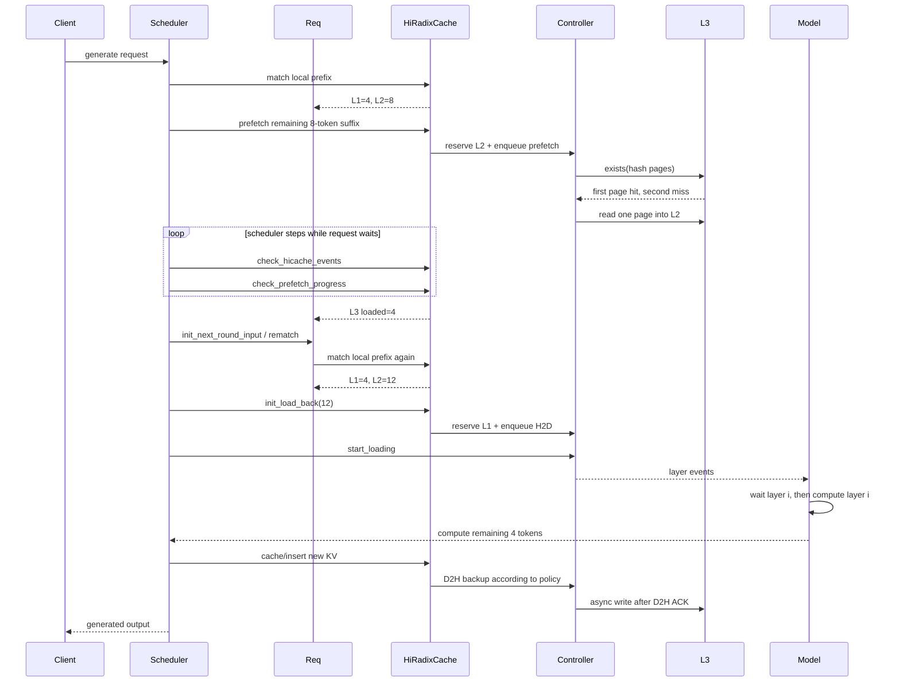
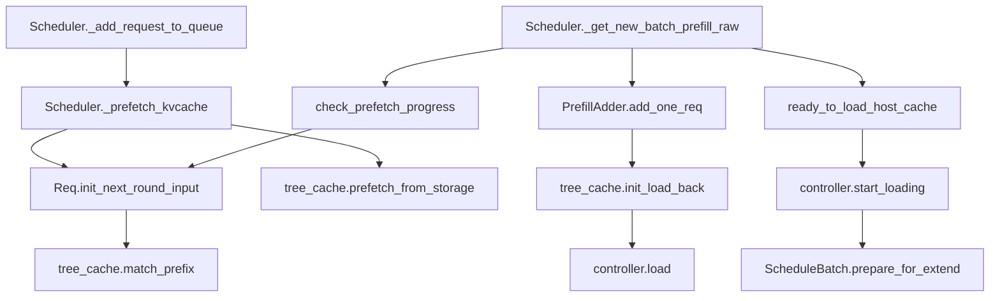

# 05. 一个请求的完整生命周期

本章用普通非 PD、经典 MHA 路径跟踪一个请求。Unified 和 PD 的差异在后续章节单列。

## 5.1 示例条件

```text
page_size = 4
请求输入 = 20 token
L1 已缓存前 4 token
L2 已缓存接下来 8 token
L3 已缓存再后面 4 token
最后 4 token 未缓存
```

理想结果：前 16 token 被复用，只计算最后 4 token。

## 5.2 总时间线



## 5.3 阶段一：请求创建与首次本地匹配

Scheduler 收到 tokenized request，构造 `Req`。`Req` 中与 HiCache 相关的状态包括：

| 字段 | 含义 |
|---|---|
| `prefix_indices` | 当前可直接在 L1 使用的 device indices。 |
| `host_hit_length` | 主 KV 在 L2 命中的 token 数。 |
| `swa_host_hit_length` | SWA 组件 L2 命中。 |
| `mamba_host_hit_length` | Mamba 状态 L2 命中。 |
| `best_match_node` | 本地树上最深匹配节点，可能是 host-only。 |
| `last_node` | 当前 L1 连续前缀的最后节点。 |
| `last_host_node` | L1+L2 连续前缀的最后节点。 |
| `storage_hit_length` | 本轮 L3 成功加载并发布的 token 数。 |

`req.init_next_round_input(tree_cache)` 调用 `match_prefix_for_req()`，最终进入 tree 的 `match_prefix()`。

首次结果：

```text
prefix_indices length = 4
host_hit_length = 8
matched local length = 12
last_node = L1 第 4 token 所在节点
last_host_node = L2 第 12 token 所在节点
```

## 5.4 阶段二：请求入队时发起 L3 预取

`Scheduler._prefetch_kvcache(req)` 只在启用 L3 时运行。它先确保请求完成本地匹配，然后检查 `last_host_node` 是否有可靠 host anchor：

```text
last_host_node.backuped 或 last_host_node 是 root
```

随后计算：

```text
matched_len = len(prefix_indices) + host_hit_length
new_input_tokens = full_input[matched_len:match_end]
```

示例中给第 13 到 20 token 发 prefetch。这里传入的 `last_hash` 来自第 12 token 所在页，保证后续页 hash 连接到正确上下文。

请求随后进入 waiting queue。预取与排队时间重叠，而不是等请求已经选入 batch 才开始查 L3。

## 5.5 阶段三：后台完成 L3 query/read

控制器分两段工作：

1. Query thread 生成候选页 hash，调用 backend `batch_exists`，得到最长连续命中；
2. I/O thread 调 `batch_get`/`batch_get_v2`，把成功页写入预留 L2 slots。

示例中候选两页只有第一页存在：

```text
backend hit = 4 token
completed_tokens = 4
第二页预留的 L2 slots -> host_mem_release_queue
```

此时数据字节已经在 L2 buffer，但 Radix 树还未必发布节点。后台线程不会直接修改树，因为树属于 Scheduler 线程控制面。

## 5.6 阶段四：Scheduler 收割预取

每个 scheduler step 调 `tree_cache.check_hicache_events()`，同时在扫描 waiting queue 时调用：

```python
prefetch_done = tree_cache.check_prefetch_progress(req.rid)
```

若 stop policy 尚不允许终止，请求本轮跳过，不进入 batch。允许终止后：

1. 标记 operation terminate；
2. 读取 `completed_tokens/hash_value`；
3. 跨 rank 取共同最小完成长度；
4. 用 `_insert_helper_host()` 把成功页插入 host Radix 树；
5. 释放“实际上已被已有节点覆盖”的重复 host slots；
6. 释放 rank 间多出来的尾部；
7. 记录 `prefetch_loaded_tokens_by_reqid[req_id]`；
8. 删除 `ongoing_prefetch` 并归还 prefetch 容量计数。

Scheduler 随后 pop 该值到 `req.storage_hit_length`。

### 为什么要重新匹配

L3 prefetch 发起后，其他请求可能也插入了相同前缀；节点可能分裂；L1/L2 也可能变化。因此不能沿用首次匹配结果。`req.init_next_round_input()` 再次匹配，示例变为：

```text
L1 = 4
L2 = 原有 8 + L3 新载入 4 = 12
```

## 5.7 阶段五：PrefillAdder 做容量预算

`PrefillAdder.add_one_req()` 同时考虑两种不同成本：

### 计算 token

L2 命中不需要重新 prefill，因此：

```text
real_input_tokens = candidate_extend_tokens - host_hit_length
```

### GPU 槽位

L2 命中虽不重算，却仍需在 L1 占槽。因此总 token/L1 预算不能把它完全忽略。

这是一个常见误区：**缓存命中减少计算，不一定减少 GPU KV 容量需求。** 对完整上下文注意力，回载后的历史 KV 仍要驻留 L1 供 decode 使用。

在锁住 `req.last_node` 后，若 `req.needs_host_load_back()`：

```python
new_indices, req.last_node = tree_cache.init_load_back(...)
req.prefix_indices = torch.cat([req.prefix_indices, new_indices])
```

示例中 `new_indices` 长度应为 12。

## 5.8 阶段六：L2 到 L1 回载

经典 `load_back()` 从最深 host node 向上走，直到找到仍有 L1 的祖先，收集连续 host-only 节点：

```text
L1 ancestor
  -> host-only node 1 (8 token)
  -> host-only node 2 (4 token)
```

然后：

1. 锁住 L1 ancestor；
2. 检查总长度是否达到 load threshold；
3. 检查 mem quota；
4. 临时保护 host nodes，避免分配/发布过程中被 host eviction；
5. Controller 分配 12 个 device slots；
6. 不足时先淘汰 L1 再重试；
7. 成功后把 device indices 切回各节点并设置 `node.value`；
8. 增加 last node 锁并登记 `ongoing_load_back`；
9. 返回 indices 给请求。

注意第 7 步发生在异步 H2D 真正完成前。此时控制面已知道“这些 device slots 将装什么”，但模型必须通过 loading event 等待数据面完成。

经典实现会在 `load_back()` 返回前释放第 4 步的临时 host ref。此后安全性依靠两点：节点已有 `value`，不再满足只淘汰 host-only 节点的条件；L1 `lock_ref` 一直保留到 H2D ACK。不要误以为 host ref 覆盖了整个 H2D。

## 5.9 阶段七：合并 H2D 并逐层等待

Scheduler 构建好本轮 `ScheduleBatch` 后调用：

```python
consumer_index = tree_cache.ready_to_load_host_cache()
```

Controller 的 `start_loading()`：

1. 合并多个请求的 `CacheOperation`；
2. 选择一个 `LayerDoneCounter` producer slot；
3. 在 load stream 中循环各层；
4. 每完成一层 H2D，就 record 对应 event；
5. 返回 producer/consumer index 给 batch。

模型 forward 消费第 i 层 KV 前等待第 i 层 event。于是可以形成流水：

```text
时间 ->
H2D:    layer0 | layer1 | layer2 | layer3
Compute:       layer0 | layer1 | layer2 | layer3
```

如果没有逐层 event，只能等所有层 H2D 完成后开始计算，TTFT 更高。

## 5.10 阶段八：计算 miss 后缀

示例中请求现在有 16 token 的 `prefix_indices`，模型只 extend 最后 4 token。`ScheduleBatch.prepare_for_extend()` 调 `alloc_for_extend()`，先为请求分配/复用 `req_pool_idx`，再为 4 个 miss token 分配 L1 slots，并把“16 个前缀 slots + 4 个新 slots”写入 `req_to_token` 行。每层 attention forward 随后通过 `set_kv_buffer()` 把新 KV 字节写进这些 slots。

同一阶段还会在请求的第一个有效 prefill chunk 记录缓存来源：`device=prefix-host_hit`，`storage=min(host_hit, storage_hit_length)`，其余 host hit 归为 `host`。它写入 `cached_tokens_device/host/storage`，用于请求输出和 Prometheus 指标；不发起新的缓存操作。由于并发去重后 L3 页可能由另一个请求先发布，这是一套请求归因口径，不是 backend I/O 的物理来源账本。

forward 前，`ScheduleBatch.prepare_for_extend()` 还会确保 batch 的 consumer index 与 controller 的 layer done counter 对应，避免某一批误等另一批事件。

## 5.11 阶段九：把新结果加入共享树

forward 结果回到 `SchedulerBatchResultProcessor` 后，根据请求是否完成调用树缓存逻辑：

- 未完成：`cache_unfinished_req()`，插入新前缀、重新匹配、更新请求映射和锁；
- 已完成：`cache_finished_req()`，插入最终可缓存部分并结束请求所有权。

新节点是否立即 D2H 由写策略决定：

- `write_through`：首次达到条件就备份；
- `write_through_selective`：insert 路径的 `hit_count` 达到阈值后备份；单独 `match_prefix()` 不会增加这个计数，chunked insert 也跳过；
- `write_back`：L1 淘汰时才备份。

D2H 完成后再异步写 L3。客户端收到输出与 L3 写完成不一定同步；L3 写由后台线程继续推进。

## 5.12 Decode 阶段

每生成新 token：

- 新 token KV 分配在 L1；
- request-to-token mapping 延长；
- 当前请求持有 last node 路径锁；
- decode 内存不足时可能 retract 请求，释放/缓存当前 KV；
- `update_running_batch()` 会尽早 `flush_write_through_acks()`，释放已完成 D2H 节点的 L1 锁，增加可淘汰空间。

这解释了为什么写入虽然是后台动作，却会影响高并发调度容量：D2H ACK 未及时收割时，相关 L1 节点仍被保护，allocator 可用空间下降。

## 5.13 请求结束或 abort

正常结束需要释放请求持有的 tree lock 和 req-to-token slot，并让缓存节点继续由树拥有。

Abort 更复杂，因为可能同时存在：

- 未发出的 prefetch；
- query 已完成但 read 未完成；
- 部分 L3 页已写进预留 L2；
- host node 已插入；
- H2D 已排队；
- storage write 正在使用 host indices。

`release_aborted_request()` / Scheduler abort path 通过 terminate 标记、barrier、release queue 和 ongoing dict 清理。后台线程不直接 free host slots，避免与调度线程/rank 不同步。

## 5.14 每个阶段的状态快照

| 阶段 | `prefix_indices` | `host_hit_length` | `ongoing_prefetch` | `ongoing_load_back` | 真正可计算 |
|---|---:|---:|---|---|---:|
| 首次本地匹配 | 4 | 8 | 无 | 无 | 4 |
| L3 已排队 | 4 | 8 | 有 | 无 | 4 |
| L3 数据已读未收割 | 4 | 8 | 有 | 无 | 4 |
| 收割并重新匹配 | 4 | 12 | 无 | 无 | 4 |
| H2D 已排队 | 16 个索引已发布 | 12 | 无 | 有 | 仍需等 layer event |
| H2D/事件完成 | 16 | 12 | 无 | 将被收割 | 16 |
| miss 后缀算完 | 20 | 0/重置 | 无 | 无 | 20 |

“索引已经出现在请求里”与“数据已经能被 kernel 读取”之间，正是 loading event 的职责。

## 5.15 关键函数调用图



源码对照：

- [A17 Scheduler](appendix/A17-scheduler-integration.md)
- [A18 Schedule policy](appendix/A18-schedule-policy.md)
- [A19 Req/Batch state](appendix/A19-request-batch-state.md)
- [A19b Forward result commit](appendix/A19b-result-cache-commit.md)
- [A02h L1 allocation/release](appendix/A02h-request-allocation-flow.md)
- [A04 HiRadixCache](appendix/A04-hiradix-cache.md)
- [A05 Controller](appendix/A05-cache-controller.md)

下一章把读路径每个失败点单独拆开：[L1/L2/L3 读路径](06-read-path.md)。
