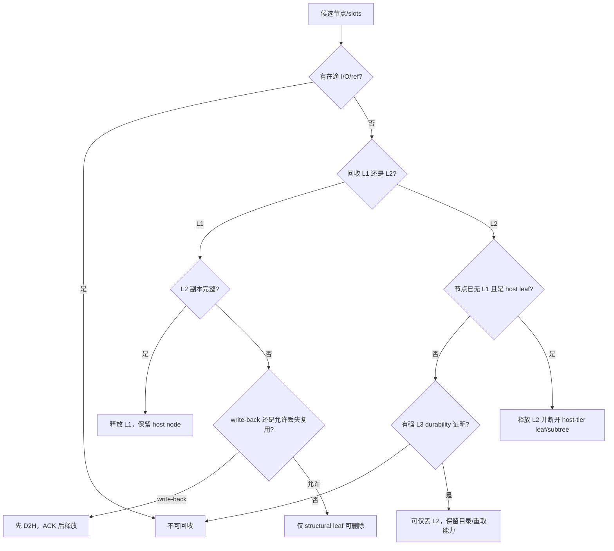

# 08. 淘汰、容量与资源所有权

## 8.1 淘汰不是删除一个字典项

一个 Radix 节点可能同时拥有 L1、L2、L3 三层副本，并被请求、D2H、H2D、L3 I/O 引用。淘汰必须回答：

1. 淘汰哪一层的副本？
2. 低一层是否真的可恢复？
3. 是否有在途操作仍会读写这些槽位？
4. 删除节点会不会切断后代前缀？
5. 各 rank 是否做出相同决定？

## 8.2 两个 allocator，两种容量

### L1 allocator

由模型的 `token_to_kv_pool_allocator` 管理 GPU slots。Scheduler 的 batch 预算、decode 空间和 HiCache load-back 都从这里申请。

### L2 allocator

`HostKVCache` 预分配固定 slots，核心状态：

```text
free_slots: 当前空闲 slot 索引
slot_used:  每个 slot 的占用标记
lock:       保护 alloc/free
```

`alloc(n)` 成功后这些 slots 已归调用方，即使 I/O 尚未开始；`free(indices)` 后它们可能立即被下一次操作重用。

因此 **free 是所有权转移，不只是容量计数减一**。

## 8.3 L1 淘汰候选的三种处理

这里的候选通常是 **device leaf**：它没有仍驻留 L1 的 child，但结构上仍可能有 host-only children。是否能删除整个节点，还要额外满足 structural leaf 条件。

### 有 L2 副本的 device leaf

淘汰 L1 后：

```text
node.value = None
node.host_value 保留
节点仍留在树上，成为 host-only leaf
```

这叫 demotion。未来可从 L2 load back。

### 没有 L2 副本的 structural leaf

如果写策略允许直接丢弃，它的 GPU indices 被释放，节点从树删除。未来只能从更短祖先重算。

### 没有 L2 副本但必须 write-back 的 device leaf

先分配 L2 并 D2H。只有写回完成后才能释放 L1。写回期间源 L1 受锁保护，目标 L2 受 operation 所有权保护。

## 8.4 为什么基本淘汰从 leaf 开始

删除非叶节点会切断所有 descendants：

```text
root -> A -> B
          -> C
```

直接删除 A，B/C 都失去可达路径。安全做法是：

- 只有 structural leaf 才能从 parent 的 `children` 中删除；
- 或仅移除某一层 value，让节点元数据和 children 保持；
- leaf 删除后 parent 若无 child，再把 parent 加入候选。

`evictable_leaves` 和 `evictable_host_leaves` 是性能索引，不是真相本身。每次结构变化都必须更新它们；实际删除前仍应验证 leaf 条件。

## 8.5 L1 eviction priority

缓存实现通过 eviction strategy 为 leaf 计算 priority，并放入 heap。具体策略可考虑最近访问、命中次数等；流程共同点：

```text
构造当前可淘汰 leaf heap
  -> 取优先级最低节点
  -> 再验证锁/状态
  -> 根据 write policy 选择 demote/delete/write-back
  -> 更新 parent leaf 状态
  -> 达到目标 token 数或无候选时停止
```

Heap 中的节点可能在构造后因分裂、锁或异步 ACK 改变状态，所以 pop 后不能无条件操作。

## 8.6 L2 淘汰为什么更保守

当前经典 `evict_host()` 只处理：

- 已没有 L1 的节点，即 `node.evicted`；
- `lock_ref == 0`，没有请求或 L1 路径锁仍保护它；
- 是 host-tier leaf，即其 children 中没有仍带 `host_value` 的节点；它不一定是 `children == 0` 的 structural leaf；
- `host_ref_counter == 0`，没有 L3 I/O 或控制面生命周期引用仍使用其 L2 slots。

这里还有一个实现细节：`_update_host_leaf_status()` 在节点进入候选集合时检查 `node.evicted`、`lock_ref` 和带 host 副本的 child；`evict_host()` 从集合弹出后会重新检查 `node.evicted` 与 `host_ref_counter`，但不会再次检查 `lock_ref`。正确性因此依赖 Scheduler 线程串行修改 Tree，并在 lock 变化时同步维护候选集合。若未来允许其他线程修改 Tree，或把候选集合做成长期快照，就必须在实际释放点重新验证全部条件。

它释放 `host_value` 后会从 parent 断开该节点；由此一起丢弃的后代不能再含需要保留的 L2 副本。若 parent 也成为无 L1 的 host-tier leaf，再继续向上。

删除本地 host-only 子树并不等于删除 L3 数据。未来同一请求先匹配到更短的本地祖先，再从该祖先的最后一个链式 hash 继续计算后续 page hash，仍可重新查询 L3。这依赖两个前提：L3 页确实完整存在，以及 L3 namespace 与当前请求的模型/rank/计算语义完全一致；本地 `extra_key` 本身不会自动进入原生页 hash，详见 [数据对象与状态契约](03b-state-and-data-contracts.md#3b10-两套-key-namespace-不要混为一谈)。

### 为什么不直接丢有 L1 的冗余 L2 副本

从理论上说，只要 L1 仍在，丢 L2 后当前请求还能计算；只要 L3 已确认完整存在，未来也能恢复。但当前经典节点没有一个强持久化状态字段证明：

```text
该节点所有页在所有必要 rank/pool 的 L3 写入已成功
```

`storage ACK` 只表示 operation 结束，`completed_tokens` 还可能小于计划值。若仅凭“发过写请求”就回收 L2，L1 一旦随后淘汰，数据可能永久失去可复用副本。

所以放宽 L2 回收前需要显式的 durability metadata，例如：

- 每节点/每页 `storage_committed`；
- 只在完整 batch_set 成功、跨 rank 共同确认后设置；
- 节点分裂时按页继承；
- backend clear/detach/TTL/eviction 后失效；
- auxiliary pool 也必须共同 committed。

没有这层状态，保守保留 L2 是正确性选择，不只是容量策略。

## 8.7 各操作的资源所有权

### L1 -> L2 写穿

| 阶段 | L1 indices 所有者/保护 | L2 indices 所有者/保护 |
|---|---|---|
| D2H 前 | Tree node + `lock_ref` | `CacheOperation`，已分配未完成 |
| D2H 中 | stream 读取，node 不能淘汰 | stream 写入，不能复用 |
| D2H ACK 后 | 可按策略淘汰 | Tree node `host_value` |
| L3 写中 | 可存在或淘汰 | Tree node + `host_ref_counter` |
| L3 ACK 后 | 独立 | Tree node，可在满足 host eviction 条件时释放 |

### L3 -> L2 prefetch

| 阶段 | L2 indices 所有者 |
|---|---|
| 预分配 | `ongoing_prefetch` / operation |
| query miss 尾部 | release queue，等待 Scheduler free |
| read 中 | operation，后台线程写入 |
| completed 未收割 | operation，不能进入树或复用 |
| 收割成功 | 新 host TreeNode |
| 与已有前缀重复 | release queue/free |
| abort | terminate 后按 completed 范围和未用范围清理 |

### L2 -> L1 load-back

| 阶段 | L2 | L1 |
|---|---|---|
| 分配前 | host nodes | 无 |
| `load_back()` 组装/分配 | 临时 `protect_host()`，防止分配过程中被 host eviction | operation 持有新 slots |
| H2D 排队及执行 | 临时 host ref 已释放；`host_value` 仍挂在同时拥有 L1 的节点上，经典 `evict_host()` 不会选择它 | `node.value` 已发布，整条恢复路径由 `lock_ref` 保护 |
| node.value 发布 | 节点同时有 L1/L2 | `lock_ref` 防止未完成数据淘汰/使用失序 |
| per-layer 完成 | 仍为节点 L2 副本 | 对应 layer 可被模型读取 |
| final ACK | 普通冗余 L2 | 正常 Tree node L1 |

这里有一个反直觉点：经典 `load_back()` 在调用 Controller `load()` 成功后就释放临时 `host_ref_counter`，然后才在同一次 Scheduler 调用里依次发布 `node.value`、增加 `lock_ref`，并不是把 host ref 持有到 H2D final ACK。释放 host ref 与发布 L1 之间存在一个很短的控制面窗口，安全性依赖 Tree/host eviction 只由当前 Scheduler 线程串行驱动，后台线程不会在中间直接淘汰节点。函数返回后，L2 源数据依靠“节点已经不是 `evicted`”这一 host-eviction 条件保持；L1 目标依靠 `lock_ref` 和逐层 CUDA event 保持。修改回载流程或引入并行 Tree mutation 时必须重新证明这几条保护链。

## 8.8 Release queue 的意义

为什么后台线程不直接 `mem_pool_host.free()`？

- Tree 与 allocator 生命周期决策主要由 Scheduler 线程串行执行；
- TP/CP rank 必须按共同 queue prefix 回收；
- 后台线程可能只知道数据面完成，不知道树是否已提交；
- 把 free 延后到 control queue drain，可统一统计和检查。

经典路径把 prefetch revoke、L3 backup ACK、host release 的本地 queue size 打包成 tensor，跨 attention rank 取 MIN，只 drain 所有 rank 共同拥有的前缀数量。

## 8.9 为什么 queue size 也要跨 rank 取 MIN

假设：

```text
rank0 release queue: [page A, page B]
rank1 release queue: [page A]
```

本轮共同 drain 1 项。若 rank0 自行多释放 B，它可能很快重用该 slot，而 rank1 仍认为对应 operation 在途。之后同一逻辑节点在不同 rank 指向不同生命周期阶段，容易出现错误数据或 collective 分叉。

## 8.10 容量计数的三个口径

### allocator available

物理上可立即分配的空 slots。

### tree evictable size

理论上通过淘汰可释放的 token。受 lock_ref、leaf 和写策略影响。

### protected/in-flight size

已经占用且当前不能释放的部分，包括：

- 活跃请求前缀；
- pending D2H 源；
- pending H2D 目标；
- L3 backup host refs；
- prefetch reservations；
- 非叶共享前缀。

只看 `available_size()` 无法判断“等待 ACK 后会恢复”还是“工作集长期超过容量”。

## 8.11 L2 容量压力分解

建议把 L2 used 拆成：

```text
resident_host_only
+ redundant_L1_L2
+ pending_D2H
+ pending_L3_write_protected
+ pending_prefetch_reserved
+ prefetched_completed_unpublished
+ auxiliary/draft pools
= total used
```

当前 allocator 只直接知道 total used，需要在 Tree/Controller operation 上做低开销聚合才能得到原因分解。

## 8.12 L2 小时为什么 L3 作用会骤降

L3 不是绕过 L2 直接给模型。传统路径必须：

```text
L3 -> free L2 page -> free L1 page
```

当 L2 工作集接近容量：

1. prefetch 需要先预留整段或缩短段；
2. host-only leaf 可能正被请求或 I/O 引用，不能淘汰；
3. L1/L2 冗余副本不能在无 durability 证明时激进丢弃；
4. 写穿又持续产生新 L2 数据；
5. L3 即使 backend hit，也可能在 allocation 阶段损失。

Controller 的 prefetch rate limit 以约 50% L2 容量作为 admission watermark，但它不是物理分区，也不会为写入保留一块不可借用的 50% 空间。一个较大的 operation 还可能让采样到的 occupied 短时越过阈值；因此不能用这项阈值推导“写路径至少总有一半 L2 可用”。

因此命中曲线可能不是线性下降，而是在 L2 到达某个占用阈值后快速恶化。

## 8.13 安全回收决策树



当前经典实现主要走图中保守路径；`DropCopy` 需要额外 L3 committed 元数据支持。

## 8.14 资源泄漏与过早释放的症状

| 类型 | 症状 |
|---|---|
| 漏 `dec_lock_ref` | L1 evictable 持续下降，decode retract/OOM 增多。 |
| 漏 `release_host` | L2 available 持续下降，但树 resident 解释不了占用。 |
| 漏 release queue drain | queue 深度和 occupied prefetch 增长，预取被长期 rate limit。 |
| 过早 free host | L3 写坏页、H2D 随机错误、命中后输出错误。 |
| 过早 free device | D2H 写出其他请求 KV、CUDA 非法访问。 |
| 重复 free | `slot_used` 检查或 allocator 断言。 |
| stale leaf | `non-leaf` 断言、parent child 不一致。 |

下一章：[线程、CUDA stream 与分布式同步](09-concurrency.md)。
