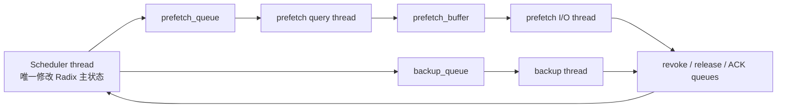
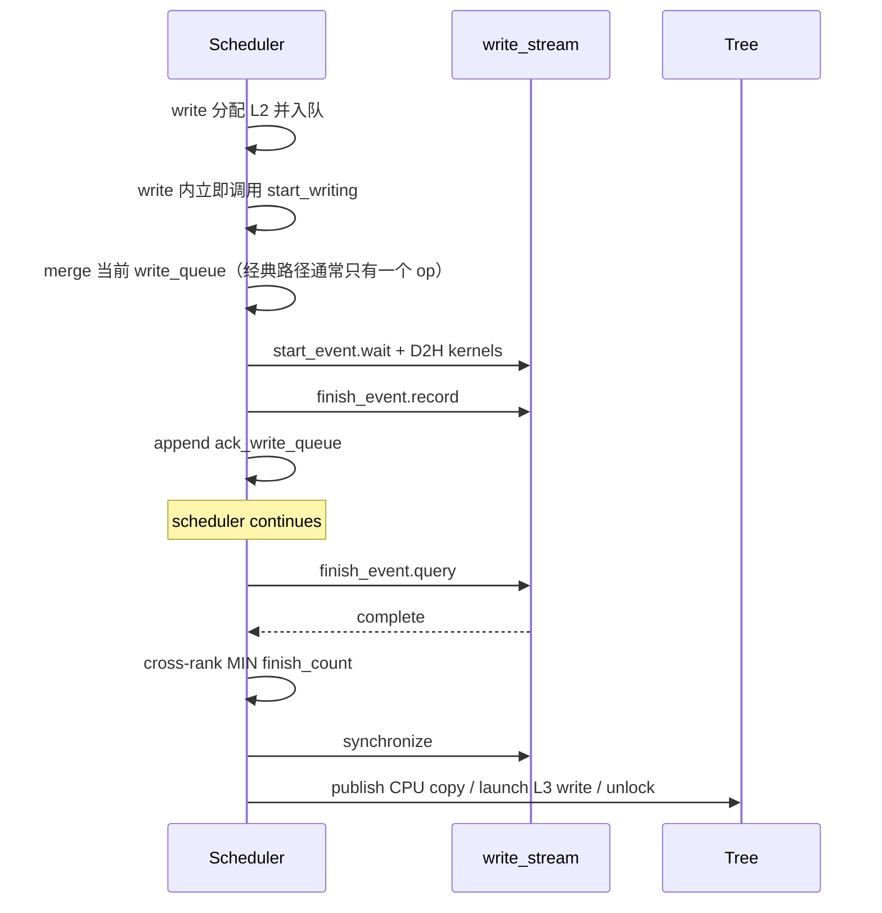
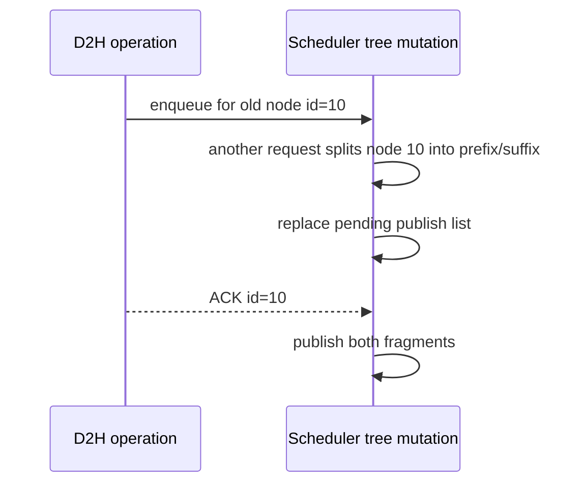

# 09. 线程、CUDA Stream 与分布式同步

## 9.1 HiCache 同时存在四种并发

1. Scheduler 主线程与 L3 后台线程并发；
2. 默认模型计算 stream 与 D2H/H2D stream 并发；
3. 同一进程中多个请求 operation 交错；
4. TP/PP/CP 多 rank 并发且必须保持共同状态。

理解 bug 时必须先说清楚发生在哪一层并发。

## 9.2 线程拓扑



后台线程主要修改 operation 内部进度和线程安全 queue，不直接改 Radix parent/children。

## 9.3 Queue 是工作移交也是所有权移交

`queue.put(operation)` 后，生产者不能假定 operation 尚未被消费。设计约定：

- Tree 创建 operation 和预留资源；
- Controller thread 只在约定字段上更新进度；
- Scheduler 通过 completed/terminate/ACK 收回控制权；
- 最终由 Scheduler 更新 Tree 并释放资源。

Python GIL 不能替代这些约定。后端调用会释放 GIL，PyTorch/C++ 操作也可并发执行；即使单条字段赋值原子，多个字段的状态转换也不是原子的。

## 9.4 `PrefetchOperation` 的共享字段

典型字段：

```text
request_id
host_indices
token_ids / hash_value
completed_tokens
start_time
termination flag（由 lock 保护）
pool transfer completion (hybrid)
```

源码中终止状态是由 `_lock` 保护的 `_terminated_flag`，不是可等待的 `threading.Event`。`mark_terminate()` 与 `increment()` 在同一把锁下竞争，使“终止后不再增加 completed token”成为原子状态转换。

关键 happens-before：

```text
backend writes page bytes
  happens-before completed_tokens increment
  happens-before Scheduler observes completion
  happens-before host node publication
  happens-before H2D read
```

如果先 increment 再写数据，控制面会发布未完成页。

## 9.5 CUDA stream 不是线程

调用 kernel 通常立即返回，GPU 命令在 stream 上排队执行：

```text
Python: launch D2H -> return -> continue scheduler
GPU write stream: [wait start] [copy all layers] [record finish]
```

因此源码需要 event 表达完成。`finish_event.query()` 不阻塞，适合 scheduler polling；确认共同可收割后再 `synchronize()` 建立 CPU 可见性。

## 9.6 D2H 的同步链



在 `scheduler continues` 这段时间里，Tree 侧的 pending id 和 `lock_ref` 仍保留；它们保证 D2H 源 L1 slots 不会在 finish ACK 提交前被淘汰。Mermaid 图中的“主线程继续运行”不等于节点已经解锁。

ACK queue 必须按头部连续完成数消费。越过一个未完成 event 收割后面的 event，可能破坏 operation 原始顺序和跨 rank 对齐。

`CacheOperation.merge_ops()` 确实存在，但经典 `HiCacheController.write()` 每次 append 后都会在返回前调用 `start_writing()` 并清空 queue，因此连续 Tree 写入通常不会在 D2H 侧形成多 operation 合批。相反，`load()` 只追加 H2D operation，Scheduler 稍后统一调用 `start_loading()`，所以 H2D 更容易真正合批。优化小 D2H 时，应先承认这个实际时序，而不是只看到 `merge_ops()` 就假设已经批处理。

## 9.7 H2D 的逐层同步链

`LayerLoadingEvent` 为每层保存 event，并另有 start/final event。`start_loading()`：

```text
for layer in layers:
    issue host -> device copy for this layer
    record layer_event[layer]
```

模型侧：

```text
before computing layer i:
    wait(layer_event[i])
```

### 三槽 `LayerDoneCounter`

连续 batch 可能重叠：batch N 仍在消费，batch N+1 已准备 H2D。环形三个 producer slot 避免一个 event 集合被下一批提前 reset/覆盖。

需要区分：

- producer index：本次 H2D 写哪组 events；
- consumer index：ScheduleBatch 应等待哪组 events；
- reset：只有该槽生命周期结束后才能复用。

## 9.8 为什么 indices 要 `record_stream()`

Kernel 不只使用 KV buffer，还使用 `host_indices/device_indices` tensor。Python 函数返回后，如果 allocator 认为这些 tensor 不再被默认 stream 使用，可能回收其底层存储。

`tensor.record_stream(stream)` 告诉 PyTorch：该 tensor 仍被这个异步 stream 使用，延迟回收直到 stream 完成。

这保护的是**索引 tensor 的内存**；Tree 的 lock/ref 保护的是**indices 指向的 KV slots**。二者缺一不可。

## 9.9 TP/Attention-TP/CP 同步

`_all_reduce_attn_groups()` 优先在 attention CP 和 attention TP group 上执行；若没有专用 group，再退到 TP group。

常见 MIN 项：

- L3 连续命中 token；
- read completed token；
- 可共同收割的 ACK 数；
- control queue 可共同 drain 的项数。

常见 MAX/布尔项：

- 任一 rank 是否 terminate；
- 是否仍有 rank 未满足停止条件。

## 9.10 PP 同步

`_all_reduce()` 在 PP0 的 attention ranks 上先 reduce，再用 `_pp_sync()` 沿 pipeline：

```text
PP0 -> PP1 -> PP2 -> ...
```

发送使用 `isend`，work 放进 `work_list`。下一轮 `check_hicache_events()` 开头 `_drain_async_work()` 等待上一轮发送完成并清空列表：

- 防止 work 无界增长；
- 给落后的 downstream stage 施加 backpressure；
- 防止发送 buffer 生命周期结束。

## 9.11 Collective 顺序是隐含协议

分布式进程必须以相同顺序调用 collective。危险代码形态：

```python
if self.ongoing_write_through:
    all_reduce(...)
```

若 rank0 有 pending、rank1 没有，rank0 进入 all-reduce，rank1 跳过并进入下一个 collective，最终死锁。

因此 `writing_check()` / `loading_check()` 即使本地 ongoing dict 为空，也进入共同同步，然后只处理共同 finish count。

## 9.12 Split 与 ACK 的竞态



若 split 不更新 pending list，ACK 持有 stale topology。修复这类竞态的原则是：operation identity 可保持稳定，但提交目标必须随结构变换更新。

## 9.13 Prefetch 与 abort 的竞态

可能顺序：

```text
Scheduler marks terminate
Read thread 正在执行 backend get
部分页已完成
Scheduler 不能立即 free 全部 host slots
```

安全策略：

- operation 的 increment 检查 termination；
- `terminate_prefetch()` 返回已经完成的 token 范围；
- 完成范围和未使用范围分别进入正确清理路径；
- attention ranks barrier/共同 drain；
- anchor host ref 最后释放。

调度层的 prefetch cutoff 只会标记 operation 终止并停止提交更多 token，不能强制中断一个正在同步执行的 `batch_exists()` 或 `batch_get()` Python 调用。若自研 L3 的 RPC 没有自己的连接、请求和重试上限，后台线程仍可能长期卡住，host reservations 也会更晚回收。因此 timeout 必须同时存在于 backend RPC 层和 Scheduler admission/等待层，两者含义不同。

## 9.14 Attach/Detach 的线程生命周期

运行时 attach 前应确保无 running/queued requests。attach 的异常路径必须 rollback：

- backend 实例创建失败不能留下 `enable_storage=True`；
- 部分线程启动后失败要发送 stop/sentinel，并在释放后端前确认 join；
- Gloo group 创建失败要销毁已建 group；
- backend 引用、page I/O 函数和 enable 状态要回到可重试状态。

经典 `HiRadixCache.detach_storage_backend()` 的实际顺序是：

1. 管理 API 先要求 Scheduler 完全 idle，从入口阻止新 storage operation；
2. 主线程本地排空现有 revoke、backup ACK 和 host-release queue；
3. Controller 设置 stop event，并向 prefetch queue、backup queue 和 prefetch I/O buffer 放 sentinel；
4. 分别最多等待 10 秒 join prefetch query、prefetch I/O、backup 线程；任一仍存活就抛错并中止 detach，不能继续释放它可能访问的资源；
5. 线程全部停止后，销毁专用 Gloo process group，并尽力调用 backend `close()`；
6. 清 backend 引用、page I/O 函数和 Controller enable 状态；
7. Tree 再次排空线程退出前写入的控制消息，并强制释放遗留 prefetch host pages、anchor host ref、backup host ref 和占用计数；
8. 最后关闭 Tree 的 storage/metrics 状态。

这里的“强制释放”只发生在线程已经确认退出后。它是 detach/shutdown 的兜底，不是正常请求路径用来抢回仍在 DMA/RPC 中 buffer 的超时机制。若线程因一个无上限的 backend RPC 卡住，detach 会失败并保留资源，调用方只能先解决 RPC 阻塞后重试。

只把 `enable_storage=False` 会留下线程、host refs 和 queue 资源。

## 9.15 并发正确性的检查方式

为每个异步动作画出四点：

```text
allocate -> enqueue -> data complete -> metadata commit -> release
```

然后检查：

1. complete 前源/目标 buffer 是否存活；
2. commit 是否只在 complete 后；
3. split/abort 是否能找到 operation；
4. 每个 rank 是否以相同顺序进入 collective；
5. release 是否只发生一次；
6. shutdown 是否覆盖所有中间阶段；
7. detach 是否只在线程停止后释放其可能访问的资源。

## 9.16 并发性能瓶颈

| 瓶颈 | 表现 |
|---|---|
| Scheduler polling 过重 | CPU 利用率高，每 token 调度延迟增加。 |
| 太多小 D2H operation | 经典 `write()` 立即启动，kernel launch/event/index 搬运难以合批。 |
| 太多小 H2D operation | `start_loading()` 虽会合批，仍可能产生较大的 concat/index 搬运开销。 |
| ACK 收割不及时 | locked L1/host refs 增长，表面像容量不足。 |
| L3 query thread 串行 | exists QPS 到顶，read 线程空闲。 |
| L3 read/write 共用后端限流 | 写压挤占读，TTFT 增加。 |
| load stream 与计算争带宽 | H2D 或 layer compute 同时变慢。 |
| rank tail latency | MIN 由最慢 shard 决定，平均值看不出。 |
| release queue 批量过小 | allocator lock 和 collective 次数高。 |

下一章：[L2 内存布局与搬运内核](10-host-layout-and-kernels.md)。
