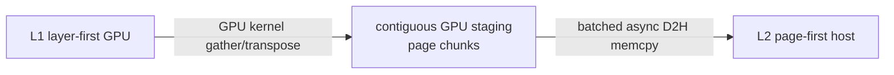

# 10. L2 内存布局与搬运内核

完整代码见 [A06 Host Pool 基类](appendix/A06-host-pool-base.md)、[A08 MHA Host Pool](appendix/A08-host-pool-mha.md)、[A09 模型特化 Pool](appendix/A09-model-specific-host-pools.md)、[A12 JIT Python](appendix/A12-jit-python.md) 和 [A21 C++/CUDA 内核](appendix/A21-kernel-cpp.md)。

## 10.1 为什么 layout 很重要

同一批 KV 数据可以按不同维度顺序排布。不同操作偏好不同连续方向：

- H2D 逐层加载，希望一个 layer 的 token 连续或易索引；
- D2H 写回所有层，希望一次 kernel 覆盖全部 layer；
- L3 以 page 为单位读写，希望一个 page 的全部层连续；
- 零拷贝后端希望每页能用少量 `(pointer, size)` 描述；
- O_DIRECT 还要求地址和长度页对齐。

不存在对所有方向都最优的 layout，所以源码有多种实现和 staged 转换。

## 10.2 MHA 的四种 host layout

符号：

```text
2 = K/V
L = layer_num
S = token slot count
P = page count
PS = page_size
H = KV head count
D = head_dim
```

### `layer_first`

```text
shape = [2, L, S, H, D]
```

同一 layer 的所有 token 连续。逐层 H2D 直观，K/V 每层可用独立指针。一个 page 的所有层分散在 L 个区域，L3 页写可能需要多段地址。

### `page_first`

源码 tensor 形状：

```text
shape = [2, S, L, H, D]
```

由于 S 仍按 token slots 展开，逻辑上每 `page_size` 个 token 组成连续页。一个 token/page 的全部层靠近，便于 L3 整页读写。

逐层 H2D 时通过：

```python
k_transposed = k_buffer.transpose(0, 1)
k_data_refs = [k_transposed[i] for i in range(layer_num)]
```

建立 strided per-layer view。`transpose` 只改 stride，不复制数据；内核必须正确处理不同 src/dst stride。

### `page_first_direct`

```text
shape = [2, P, L, PS, H, D]
```

显式 page 维度，适合 direct I/O。逻辑 token index `index` 对应物理 page：

```text
real_index = index // page_size
```

调用者通常传每页起始 token index。

### `page_head`

```text
shape = [2, P, H, PS, L, D]
```

把 head 放到 page 内较高维，便于异构 rank 按 head 切分同一页。`get_split_heads_page_buffer_meta()` 能为每页每个 head 分片生成 K/V 指针和字节数。

## 10.3 图解布局差异

假设 2 层、每页 2 token：

```text
layer_first:
K: [L0:t0 t1 | t2 t3 ...] [L1:t0 t1 | t2 t3 ...]
V: [L0:t0 t1 | t2 t3 ...] [L1:t0 t1 | t2 t3 ...]

page_first:
K: [t0:L0 L1] [t1:L0 L1] | [t2:L0 L1] [t3:L0 L1]
V: [t0:L0 L1] [t1:L0 L1] | [t2:L0 L1] [t3:L0 L1]
```

前者按层连续，后者按 token/page 聚合层。

## 10.4 `token_stride_size` 与 `layout_dim`

MHA 中：

```text
token_stride_size = head_num × head_dim × dtype_bytes
layout_dim = token_stride_size × layer_num
```

- `token_stride_size`：一个 layer 中一个 token 的 K 或 V 字节数；
- `layout_dim`：一个 token 跨全部 layer 的 K 或 V 字节数。

搬运 API 根据 src/dst layout 使用不同 stride。stride 算错不会总是越界，可能只是把 layer/token 错位，输出悄悄错误，因此比显式 crash 更危险。

## 10.5 Host pool 的物理分配

`HostKVCache.__init__()`：

1. 从 device pool 读取 dtype、层范围等；
2. 计算每 token 字节；
3. 决定 token slots 并按 page 对齐；
4. 检查 host 可用内存，保留系统余量；
5. 选择 `ALLOC_MEMORY_FUNCS[device]`；
6. 根据 allocator type 分配 tensor；
7. 初始化 free slots。

默认常使用 pinned memory。Pinned 意味着物理页不会被 OS 随意换出，GPU DMA 可直接访问；代价是大量 pinned memory 会压缩操作系统可分页空间，配置过大可能拖慢整机。

## 10.6 `kernel` I/O backend

Kernel 路径让 GPU kernel 根据离散 indices 搬运：

```text
for logical item i:
    src_slot = indices_src[i]
    dst_slot = indices_dst[i]
    copy one token's K/V bytes
```

### H2D

`load_to_device_per_layer()` 每次处理一层，适合逐层 event 与计算 overlap。

### D2H

`backup_from_device_all_layer()` 一次处理全部层，减少 Python/kernel launch 次数。

JIT 内核要求某些 element size 对齐；`can_use_hicache_jit_kernel()` 会尝试编译/加载，失败时返回 False，由 host pool 选择 `sgl_kernel.kvcacheio` 备用实现。

这类 fallback 应保持正确性，但性能可能明显不同。启动 warning 必须纳入基准记录。

## 10.7 `direct` I/O backend

Direct 路径调用能处理 host/device tensor 指针的批量传输函数。索引可能需要在 CPU：

- layer-first：host indices 排序，同时重排 device indices；
- page-first-direct：保持页结构，把 device indices 转 CPU；
- 不兼容 layout 直接抛 `ValueError`。

排序不是改变 token 对应关系，而是对 `(host_index, device_index)` pair 同步排序，以提高 host 地址局部性。

## 10.8 Staged page-first write-back

L1 通常 layer-first，L2 page-first。直接从许多 layer 的离散 GPU 地址写到 page-first host 目的地，访存和调用开销不理想。

Staged 方案：



`_init_write_back_staging_buffers()` 只在兼容 layout/platform 且 JIT 可用时分配 staging K/V。容量限制为固定 page chunk，长操作循环分块，避免 staging 与整个 L2 等大。

C++ `run_staged_impl()`：

1. 从每层指针按 source page indices 聚合到 staging；
2. 尝试 CUDA batch memcpy API；
3. API 不可用时逐页 async memcpy fallback；
4. MHA 和 MLA 使用不同入口。

## 10.9 JIT 模板参数

Python 通过：

```text
element_size
unroll
block_quota
num_threads=1024
```

实例化 C++ 模板。

### `element_size`

一个 worker 需要搬运的 KV 元素字节数，决定向量打包与对齐要求。

### `unroll`

默认随元素大小调整：小元素可更高展开，大元素降低展开，平衡指令并行和寄存器压力。

### `block_quota`

限制 kernel blocks，避免 HiCache copy 占满 GPU、过度干扰模型计算。提高 quota 可能加速搬运，也可能让 forward 变慢，必须做端到端测试。

## 10.10 C++ 内核的核心映射

`hicache_transfer_per_layer` 逻辑近似：

```cpp
i = worker_index;
src_pos = indices_src[i];
dst_pos = indices_dst[i];
src = src_base + src_pos * src_stride;
dst = dst_base + dst_pos * dst_stride;
vectorized_copy(src, dst, element_size);
```

K/V 两路使用相同索引。All-layer 版本外层再遍历 layer pointer array。MLA 版本省略独立 V。

实际源码有 CUDA/ROCm 条件编译、non-coherent store、warp packaging、FFI 参数检查和 block 数计算，详见 [A21](appendix/A21-kernel-cpp.md)。

## 10.11 给 L3 的页视图

### Generic tensor 接口

- `get_data_page(index, flat=True)`：从 L2 取一页扁平 tensor 写 L3；
- `get_dummy_flat_data_page()`：创建同形目标供 backend read；
- `set_from_flat_data_page(index, data)`：把读回页写入 L2。

它简单但可能有额外临时 tensor/reshape/copy。

### Zero-copy 地址接口

`get_page_buffer_meta(indices)` 返回：

```text
ptr_list
element_size_list
```

page-first 通常每页只需 K/V 两段；layer-first 可能每页每层 K/V 各一段，元数据和远端操作数更多。

后端必须保证这些指针只在 host pool 存活且对应 slots 被引用保护时使用。

## 10.12 O_DIRECT 对齐

`is_stride_page_aligned(4096)` 检查：

```text
base pointer % 4096 == 0
per-page byte stride % 4096 == 0
```

只对齐首地址不够。第 0 页对齐但 stride 非 4096 倍数，第 1 页地址就会失去对齐。

## 10.13 K-only 与非对称 K/V

### `MHATokenToKOnlyPoolHost`

MiniMax sparse index-K 没有对应 V，所以：

- 每 token 大小没有 `×2`；
- 只分配 `k_buffer`；
- transfer API 使用 MLA 风格单缓冲函数；
- 共享主 pool 的 page/slot 数以保持索引对应。

### `AsymmetricMHATokenToKVPoolHost`

某些模型 `head_dim != v_head_dim`。不能把 K/V 放在同一个规则 `(2,...)` tensor 中，也不能共享 stride。实现分别分配 K/V buffer，并分别计算：

```text
k_token_stride
v_token_stride
k_layout_dim
v_layout_dim
```

不支持依赖单一 flat page 的部分 L3 后端，源码主动抛 `NotImplementedError`，防止用 K stride 错读 V。

## 10.14 MLA、Mamba 和多 pool

`memory_pool_host.py` 包含：

- `MLATokenToKVPoolHost`：压缩 KV/rope 等模型特定缓冲；
- `MambaPoolHost`：recurrent state 与卷积 state，不完全按普通 token KV；
- `LogicalHostPool`：只管理逻辑 indices，由实际 buffer 承载数据；
- DeepSeek V4 paged/state pools；
- `HostPoolGroup`：把多个 pool entry 暴露成统一 controller 接口；
- DSA indexer pool。

阅读这些类时沿同一模板比较：size、shape、alloc/free、H2D、D2H、page get/set、zero-copy meta。树和 Controller 的状态机不变，变化集中在“一页由哪些 tensor 构成”。

## 10.15 布局选择的性能问题

| 问题 | 更相关的选择 |
|---|---|
| 只启用 L2、H2D 很频繁 | layer-first/kernel 往往更直观，但需实测 D2H。 |
| L3 每页大块零拷贝 | page-first/page-first-direct。 |
| direct backend | page-first-direct 或明确支持的 layer-first。 |
| 写穿 D2H 成瓶颈 | staged page-first JIT 是否启用、block quota。 |
| 多 head 分片存储 | page-head。 |
| O_DIRECT | base/stride 对齐与 allocator。 |
| NUMA 多 socket | host allocation 与 GPU/网卡亲和性，比 layout 名称同样重要。 |

不要只测单向 memcpy。最终指标应同时看模型吞吐、TTFT、L3 read/write、GPU 利用率和 cache hit。

下一章：[L3 存储接口与自研后端契约](11-storage-backends.md)。
