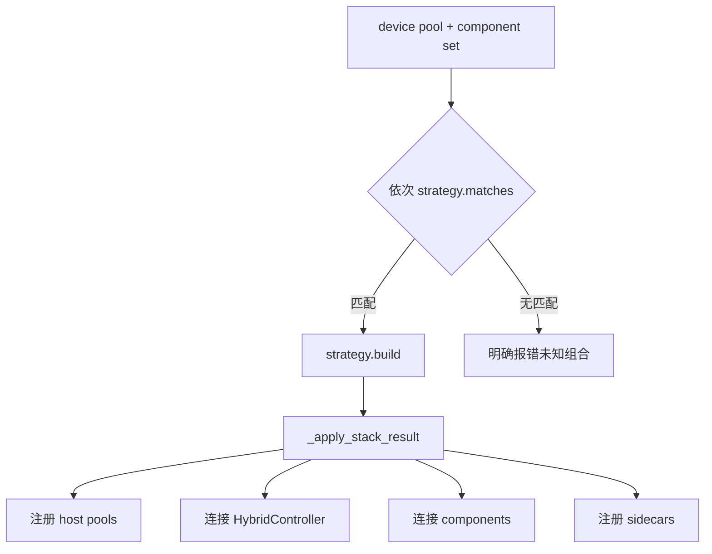

# 12. UnifiedRadixCache 与混合模型扩展

普通 MHA 路径中，一个 token 前缀主要对应一套 KV。混合模型可能同时依赖多种缓存状态，单一 `value/host_value` 不够表达，因此引入 Unified 组件模型。

完整代码见 [A13 UnifiedRadixCache](appendix/A13-unified-radix-cache.md)、[A13b TreeComponent](appendix/A13b-tree-component.md)、[A13c Full](appendix/A13c-full-component.md)、[A13d SWA](appendix/A13d-swa-component.md)、[A13e Mamba](appendix/A13e-mamba-component.md)、[A14 HybridController](appendix/A14-hybrid-controller.md)、[A15 Pool Assembler](appendix/A15-hybrid-pool-assembler.md) 和 [A09 模型特化 Host Pool](appendix/A09-model-specific-host-pools.md)。

## 12.1 为什么 Full KV 命中还不够

假设模型每层交替使用：

- Full attention KV；
- Sliding Window Attention KV；
- Mamba recurrent state。

请求前缀的 Full KV 全部存在，但对应 Mamba state 缺失。如果直接跳过 prefill：

- attention 层读到正确历史；
- Mamba 层从错误/空 state 继续；
- 最终输出错误。

因此可复用前缀必须由所有必要组件共同决定。

## 12.2 Unified 节点模型

经典节点：

```text
node.value
node.host_value
```

Unified 节点更像：

```text
node.component_data = {
    FULL_KV: ComponentData(value, host_value, ...),
    SWA:     ComponentData(value, host_value, ...),
    MAMBA:   ComponentData(value, host_value, ...),
    ...
}
```

不同组件可能：

- token 粒度不同；
- 只保存前缀尾部；
- 独立分配 slots；
- 共享主 pool indices；
- 有独立 LRU；
- 在某层没有数据。

## 12.3 Component 是策略对象

每个组件负责与自身语义有关的操作，例如：

- 如何匹配；
- 如何构造 HiCache transfer；
- 如何提交 host/device indices；
- 如何计算淘汰 token；
- 分裂节点时如何切数据；
- 某请求需要哪些额外状态。

UnifiedRadixCache 负责编排所有组件，而不是在每个函数里写大量 `if model_type == ...`。

## 12.4 组件化 LRU 与 tombstone

一个节点的 Full KV 可能已被淘汰，但 Mamba/SWA 组件仍有状态；反之亦然。Unified 不能简单用 `node.value is None` 判断整个节点死亡。

它维护：

- 每个 ComponentType 的 LRU linked list；
- 每组件 evictable/protected 状态；
- 仍为其他组件提供结构锚点的 tombstone node；
- device leaf 与 host leaf 的复合判定。

只有所有必要组件都被移除，且节点没有 child/引用时，才能迭代删除 tombstone leaf。

## 12.5 Pool Assembler 的职责

`hybrid_pool_assembler.py` 把“模型有什么”翻译为“HiCache 应创建什么”。

输入：

- device KV cache 实际类型；
- Unified tree 已注册的 ComponentType；
- ServerArgs layout/size/backend；
- TP/PP/CP group 和模型配置。

输出 `StackBuildResult`：

- 主 host pool 或 `HostPoolGroup`；
- `HybridCacheController`；
- 组件到 pool 的映射；
- sidecar specs；
- layer mapper；
- 是否与 req-to-token counter 联动。

## 12.6 Strategy 选择

策略注册顺序表示优先级。当前源码覆盖 Plain KV、SWA、Mamba、DSA、MiniMax sparse、DeepSeek V4 等组合。



未知组合报错比落到错误布局更安全。单元测试验证策略顺序、自定义策略优先级和各种组件组合。

## 12.7 `HostPoolGroup` 与 `PoolEntry`

`PoolEntry` 描述一个 pool：

```text
name
host_pool
device_pool
layer mapping / transfer metadata
```

`HostPoolGroup` 把多个 entry 暴露给 controller，并把主 KV pool 的常用属性作为兼容接口：

- allocator/size/dtype；
- `available_size/alloc/free`；
- H2D/D2H 时遍历 entry；
- L3 v2 注册每个 pool。

重要的是：各 entry 不一定拥有相同 slot 数和索引语义，Controller 不能盲目把主 KV indices 传给所有 pool。

## 12.8 `PoolTransfer` 如何贯穿三个阶段

同一数据描述用于：

### `BACKUP_HOST`

```text
device_indices -> allocate/derive host_indices
```

### `LOAD_BACK`

```text
host_indices -> allocate/derive device_indices
```

### `BACKUP_STORAGE` / `PREFETCH`

```text
host_indices <-> L3 keys
```

组件的 `build_hicache_transfers()` 构造描述，`commit_hicache_transfer()` 在资源分配/操作接受后把结果写回节点。

## 12.9 Sidecar pool

Sidecar 有自己的数据 buffer，但复用另一个真实 pool 的 indices。例如 indexer 数据与 KV page 一一对应：

```text
sidecar pool = INDEXER
indices_from_pool = KV
```

`_build_sidecar_transfers()` 根据 phase 选择 source 的 device 或 host indices。它会检查：

- source pool 是否支持；
- source transfer 名称是否匹配；
- indices 是否存在且非空。

Sidecar 不独立分配 indices，减少 allocator 状态；但其 L3 get/set 结果仍必须参与最终可用性判定。

## 12.10 Unified D2H 写路径

`UnifiedRadixCache.write_backup()`：

1. 检查父节点连续备份不变量；
2. 从 BASE/FULL KV 组件取得 device value；
3. 为每个其他组件构造 `BACKUP_HOST` transfers；
4. 构造 sidecar transfers；
5. 检查主 host pool 容量，必要时 `evict_host()`；
6. `HybridController.write(..., extra_pools=...)`；
7. 只有主操作成功后，按组件 commit host transfer；
8. 登记 write-through pending 和 lock；
9. ACK 后发布所有碎片并写 L3。

复合操作要么在 commit 前拥有足够的必要资源，要么回滚已分配资源，避免节点只有一半组件被标为 backuped。

## 12.11 Unified H2D 回载

`load_back()`：

1. 对 best match host anchor 加 host lock；
2. BASE 组件构造主 KV transfer 和 `nodes_to_load`；
3. 对每个其他组件构造 request-aware transfers；
4. 构造 sidecars；
5. 用 Full KV token 数与 threshold/quota 做主预算；
6. 检查 device allocator，必要时驱动每组件 eviction；
7. `HybridController.load()` 创建复合 H2D；
8. 成功后逐组件 commit；
9. 更新各组件 leaf/LRU；
10. ongoing load-back 同时保存 device lock 和 host anchor lock；
11. ACK 后统一释放。

即使 Full KV 因太短被 threshold 跳过，某些 auxiliary transfer 仍可能有必要执行，源码条件因此不能简单写成 `kv_tokens < threshold: return`。

## 12.12 Unified L3 prefetch

在主 KV host 预分配后，组件逐一构造 `PREFETCH` transfer。返回值有三种语义：

- `None`：该组件本次不需要 transfer；
- 非空 list：需要且资源已准备；
- 空 list `[]`：需要但分配失败，整个复合预取不能安全继续。

分配失败时必须：

- 释放主 KV host indices；
- 释放此前已分配的辅助 pool；
- 释放 anchor lock；
- 不创建 ongoing operation。

`check_prefetch_progress()` 在主 KV 插入 host tree 后，把 `insert_result` 和 `PoolTransferResult` 交给各组件 commit。各 pool 的实际成功页数决定组件能发布多少状态。

## 12.13 V2 storage hit 的共同前缀

例子：

```text
Full KV: 100 pages
SWA trailing state: supports prefix 96 pages
Mamba state: supports prefix 80 pages
Indexer: all pages through 92
=> final reusable prefix = 80 pages
```

`PoolTransferResult` 既保存 `kv_hit_pages`，也保存各 extra pool hit pages，便于组件 commit 时裁剪自己的 transfer。

## 12.14 Unified 特有的回收复杂度

经典树只需问“节点是不是 leaf”。Unified 还需问：

- 对哪个 component 是 leaf？
- 该 component 的 LRU link 是否一致？
- 移除该 component 后节点是否成为 tombstone？
- 其他 component 是否仍需 parent path？
- host 和 device 两套 leaf 集合如何更新？

`_check_lru_linked_list()` 等调试函数用于验证链表结构。组件化回收发生 bug 时，不能只看 parent.children。

## 12.15 Runtime attach 限制

当前 `UnifiedRadixCache.attach_storage_backend()` / `detach_storage_backend()` 明确返回不支持，要求启动时配置并通过重启切换。原因是多 pool、process group、sidecar 和组件状态的运行时重装配尚未提供完整安全迁移。

管理 API 调用前应根据实际 tree cache 类型处理该限制，不能假定经典 HiRadix 支持的 runtime attach 在 Unified 上也支持。

## 12.16 PD Decode 的 HiCache 路径

Prefill/Decode 分离时，decode 侧可能同时等待远端 prefill KV transfer 和本地 HiCache 恢复。`decode_hicache_mixin.py` 把逻辑分为：

### Prefix discovery

`_build_decode_prefix_match()`：

- 本地 tree match 得到 L1/L2；
- 可选同步 query L3 hit length；
- 形成 `DecodePrefixMatch`，总本地可恢复长度为三层之和。

### Start prefetch

`_start_hicache_prefetch()` 对 L1/L2 之后的 token 发正常异步 L3 prefetch。

### Queue local restore

`_try_hicache_queue_load_back()`：

1. 等 L3 prefetch stop；
2. 重新匹配；
3. 调 `init_load_back()`；
4. 保存 restored indices/node；
5. 失败则标记 `FAILED`，回到正常远端/重算路径。

### Batch H2D

`_process_hicache_local_restores()` 聚合多个 decode request 的回载，再统一 `ready_to_load_host_cache()`，给每个 request 记录 consumer index。

`HiCacheRestoreGatedKVReceiver` 还会包装原有 KV receiver：即使远端 KV transfer 已报告 `Success`，只要本地 HiCache restore 仍是 `PENDING`，对上层仍返回 `Transferring`。这样请求不会在本地 H2D 尚未可用时提前进入下一状态。

### Commit

H2D 可消费后 `_commit_hicache_local_restore_to_req()` 把 restored indices 拼到请求 prefix，并更新 last node。

完整代码见 [A16](appendix/A16-decode-hicache.md)。

## 12.17 阅读 Unified 的推荐顺序

不要从 2900 行文件第一行读到底。按顺序：

1. `ComponentType`、节点 `component_data` 相关 dataclass；
2. `UnifiedRadixCache.__init__/reset/match_prefix/insert`；
3. 一个最简单 BASE component；
4. `init_hicache`；
5. `write_backup/load_back/prefetch_from_storage`；
6. `HybridCacheController.write/load/_page_transfer/_page_backup`；
7. assembler 的 `_PlainKvStrategy`；
8. 再看与你部署模型对应的 SWA/Mamba/DSA strategy；
9. 最后看 component LRU/tombstone eviction。

下一章：[性能模型、高并发与命中率](13-performance.md)。
