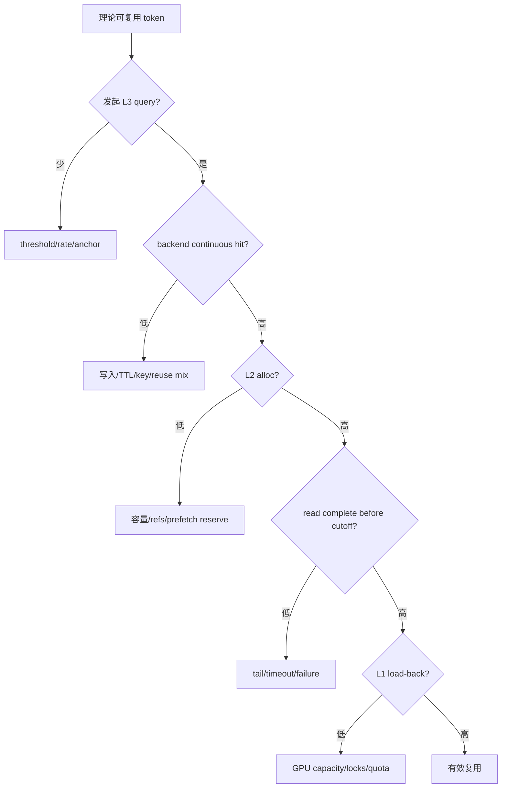

# 14. 故障定位与断言分析

## 14.1 先分类，不要先改代码

| 类别 | 典型现象 | 第一观察点 |
|---|---|---|
| 启动依赖 | native hash/JIT/backend import 失败 | 原始 exception cause、平台/编译环境。 |
| 树结构错误 | `non-leaf`、parent child、new indices 断言 | split/insert/evict/ACK 的先后关系。 |
| 资源生命周期 | double free、容量只降不升 | ongoing dict、ref count、release queues。 |
| L3 失败 | `Write page to storage failed`、short read | planned/completed pages、后端错误分类。 |
| 分布式 hang | collective 卡住 | 各 rank 最后一个 collective 序号和条件分支。 |
| 性能回退 | cache-hit/吞吐下降、TTFT 上升 | token 漏斗和 queue age，而非单一平均值。 |
| 数据正确性 | 命中后输出错、随机 NaN | key namespace、layout/stride、过早释放。 |

## 14.2 `Failed to load HiCache native hash extension`

当前快照的 `get_hash_str()` 直接调用 `get_native_hash()`，没有 Python fallback。加载器要求：

- little-endian Linux；
- PyTorch C++ extension 可用；
- C++17 编译器；
- OpenSSL headers 和 `libcrypto`；
- 可写且有空间的 torch extension cache；
- 架构/ABI 与当前 Python、PyTorch 一致。

加载器捕获底层异常后抛：

```text
RuntimeError: Failed to load HiCache native hash extension
```

真正原因在 exception chain 的 `__cause__`，可能是：

- `ninja`/compiler 不存在；
- `openssl/sha.h` 缺失；
- 链接找不到 `-lcrypto`；
- 编译 cache 权限或磁盘满；
- 旧 build 与新 torch/Python ABI 冲突；
- 非 Linux 平台。

### 建议检查

```bash
python3 -c 'import sys, torch; print(sys.platform, sys.byteorder, torch.__version__)'
python3 -c 'from torch.utils.cpp_extension import CppExtension; print("cpp extension ok")'
which c++
which ninja
pkg-config --cflags --libs openssl
df -h
```

在最小 Python 进程直接调用 `_load_native_hash_module()`，打印完整 traceback，避免服务日志只保留外层错误。

### 为什么不能随便加不同算法的 fallback

L3 key 是跨请求、rank、进程和机器共享协议。如果部分 worker 使用 C++ SHA-256 链式编码，另一些 worker 使用字节序或 bigram 编码不同的 fallback：

- exists 永远 miss；
- 更严重时可能 key 碰撞到语义不同数据；
- TP rank 共同前缀缩到 0；
- 旧 L3 数据与新版本不兼容。

Fallback 必须有逐字节一致性测试，涵盖普通 token、bigram、上一页 digest、page_size、32/64-bit 输入和边界值；所有 rank 必须选择同一实现。

源码见 [A12b](appendix/A12b-native-hash-loader.md)、[A12c](appendix/A12c-hash-utils.md) 和 [A21](appendix/A21-kernel-cpp.md)。

## 14.3 `len(new_indices)=0, len(radix_key)=3712`

断言位于 `RadixCache.cache_unfinished_req()`：刚把 `radix_key` 和 `values` 插入树，随后重新匹配同一个 key，理论上应完整得到相同长度的 device indices。

```text
insert(key=3712 tokens)
match_prefix(same key)
expected new_indices=3712
actual new_indices=0
```

这不是普通 cache miss。它说明 insert 与 rematch 之间的内部不变量不成立。

### 优先检查

1. `insert_result.prefix_len` 是否合理；
2. insert 返回的 last node 是否仍可从 root 达到；
3. root.children 是否包含 key 的首 page key；
4. 节点是否在同一 scheduler step 被 eviction 删除；
5. 分裂后 prefix/suffix 的 `value` 是否都非空且长度正确；
6. `extra_key/is_bigram/page_size` 在本地 insert 和 match 是否一致；另行检查 L3 namespace，因为 `extra_key` 不进入原生页 hash；
7. `req.last_node` 是否来自另一棵已 reset 的 tree；
8. pending D2H/H2D ACK 是否提交了 stale node；
9. host-only 优化是否错误地把仍需 device value 的节点标为 evicted；
10. allocator free 是否早于 Tree 接管 indices。

### 最小现场信息

```text
req.rid
len(token_ids), len(radix_key), page_size, extra_key, is_bigram
req.cache_protected_len, len(req.prefix_indices)
insert_result.prefix_len
old/new last_node id and parent chain
root first-level child keys
沿 key 匹配路径每节点: id/key_len/value_len/host_len/lock/children/pending
本轮 eviction、split、write/load ACK 顺序
```

不要把断言改成“如果 0 就重算”。那会掩盖树已丢失刚插入数据，后续还可能 double free 或读坏索引。

## 14.4 `AssertionError: non-leaf, node.id=...`

经典路径 `_evict_regular()` 要删除一个没有 L2 副本的节点，前置条件是结构 leaf：

```text
len(node.children) == 0
```

### 常见根因

- `evictable_leaves` 含 stale node；
- 分裂后旧节点 leaf 状态未更新；
- 淘汰 heap 构造后节点新增 child；
- 子节点只是 `value=None`，但结构上仍存在；
- `_promote_parent` 把“所有 child 的 L1 都已淘汰”误当成“parent 没有 child”；
- ACK/异步流程持有旧 topology。

### 当前快照的一个重点核对点

`_promote_parent()` 在所有 children 都 `evicted` 时把 parent 加入 device eviction heap；这表示 parent 是“device leaf”，但不表示 `children` 为空。若该 parent 自身没有 L2 backup，后续走 `_evict_regular()`，它要求“structural leaf”，两种 leaf 定义发生冲突就会触发断言。

排查时打印：

```text
node.id, node.backuped, node.evicted, node.lock_ref
[(child.id, child.evicted, child.backuped, child.host_ref_counter) ...]
node 是否来自初始 heap 还是 _promote_parent
```

正确修复应明确：

- 是只释放 parent 的 L1 value、保留 host-only descendants；
- 还是安全删除整个无 host subtree；
- 还是只有结构 leaf 才能进入 regular delete heap。

不能简单移除 assert 后调用 `_delete_leaf()`，否则会断开 children。

## 14.5 `Write page to storage: N pages failed`

日志来自 Controller `_page_backup()`：当前 batch 的 `page_set_func` 返回失败。

要收集：

```text
backend type / shard / rank
operation id
planned pages/tokens/bytes
failed batch start offset and size
completed_tokens before failure
backend exception/error code
queue wait vs backend service latency
host indices 是否 page-aligned、仍被 ref 保护
```

### 分层判断

1. L2 D2H 是否已经完成？若未完成，源页本身不可靠。
2. `get_data_page/get_page_buffer_meta` 给出的大小是否与后端预期一致？
3. Backend 是容量拒绝、连接失败、timeout、partial result 还是校验失败？
4. 后端 partial success 是否被错误聚合成单 bool？
5. 同 key 并发写是否被当成错误，而不是幂等成功？
6. 写成功返回是否早于后端实际读完 host pointer？

该日志增多会影响未来 L3 命中，但不一定立即影响当前 L2 命中。

当前经典 `_page_backup()` 正会把 V1 的逐页结果用 `all(...)` 聚合：一批中任一页失败，该批 `completed_tokens` 整体不增加并停止后续批次。因而必须把“后端实际成功页数”和“HiCache 控制面确认的连续成功 token”分开记录，不能只靠这条 warning 反推物理写入数量。

## 14.6 Cache-hit 随并发下降

按漏斗排查：



运行结束 queue=0 不能排除运行中排队。需要 peak、oldest age 和 cumulative token loss。

## 14.7 “加统计后明显变慢”

高频指标可能引入：

- 每 operation 的 Python 锁竞争；
- 大量 f-string 即使日志级别关闭也先格式化；
- 每页/每 token logging；
- `tensor.item()/cpu()` 造成 GPU 同步；
- `qsize()` 高频调用和多个 queue 遍历；
- 为累计值维护大 list/histogram；
- 在后台读写线程争同一 metrics lock；
- 每 10 秒汇总时遍历整棵树，造成长 pause；
- 新增 collective 同步所有 rank。

### 验证方法

1. 在完全相同 seed/workload 上做 A/B；
2. 分别关闭日志输出、保留 counter，区分 I/O 与计数开销；
3. `py-spy/perf` 看 Scheduler 和 backend thread CPU；
4. Nsight 看是否新增 host sync；
5. 记录 scheduler step p99，而不只总耗时；
6. 检查 counter 更新是否位于 per-page 内循环；
7. 用局部整数累加，周期交换快照，避免每次获取全局锁。

## 14.8 分布式 hang

第一原则：找每个 rank 最后进入的 collective，不要先看 GPU kernel。

检查：

- 某 rank 是否因本地 ongoing dict 为空跳过 all-reduce；
- exception 是否让某 rank 提前退出 scheduler step；
- TP/attention TP/CP group 是否选错；
- PP `_pp_sync` send/recv 次序和 tag 是否一致；
- detach 是否销毁了仍被线程使用的 group；
- queue drain 本地数量是否在同步前被其他线程改变；
- Unified 必要 pool 分配失败是否只让部分 rank return。

建议日志携带：`global rank, tp/pp/cp rank, scheduler step, collective sequence id, operation type`，但只在 debug 构建/采样输出。

## 14.9 L2 容量持续下降

建立守恒式：

```text
allocated_total - freed_total = current_used
```

再把 current used 与以下集合求和对照：

- 所有树节点 host_value unique indices；
- ongoing prefetch reservations；
- ongoing D2H targets；
- ongoing L3 backup protected nodes；
- release queue 尚未 free indices；
- auxiliary/draft pool allocations。

若 allocator used 大于可解释集合，是资源泄漏或统计漏项；若小于，是重复所有权/重复索引，可能随后 double free。

注意去重：分裂链、sidecar 或 operation 可能暂时从多个控制对象引用同一 slots。

## 14.10 命中后输出错误

这是最高优先级问题，应立即停止把 cache-hit 当性能收益。重点：

1. 本地 `extra_key` 是否包含所有影响 KV 的 adapter/multimodal 信息，且 L3 是否另有等价 namespace；当前原生页 hash 不包含 `extra_key`；
2. page hash 在所有机器是否逐字节一致；
3. TP/PP/CP namespace 是否冲突；
4. host layout stride、K/V offset、dtype 是否正确；
5. 非对称 K/V 是否误走共享 stride；
6. L3 get 返回 True 前是否写完 target；
7. L3 set 返回后是否还异步读取已释放 source；
8. H2D 是否等待对应 layer event；
9. slot 是否被过早 free/realloc；
10. auxiliary pool 是否被错误视为可选。

建议给测试页写入可辨识 pattern，逐层/逐 head 比较 L1 -> L2 -> L3 -> L2 -> L1 的 bitwise 或允许量化误差的结果。

## 14.11 Tree validator 思路

Debug 模式可在低频安全点递归验证：

```python
def validate(node):
    for child_key, child in node.children.items():
        assert child.parent is node
        assert child.key.child_key(page_size) == child_key
        assert len(child.key) > 0
        if child.value is not None:
            assert len(child.value) == len(child.key)
        if child.host_value is not None:
            assert len(child.host_value) == len(child.key)
        if child.hash_value is not None:
            assert len(child.hash_value) * page_size == len(child.key)
        validate(child)
```

再验证 leaf sets、ongoing pending id 和 allocator indices。不要在生产每 scheduler step 全树遍历。

## 14.12 现有测试入口

重点测试：

```text
test/registered/unit/mem_cache/test_hiradix_cache_unit.py
test/registered/unit/mem_cache/test_hiradix_pp_sync_drain.py
test/registered/unit/mem_cache/test_unified_radix_hicache_dispatch.py
test/registered/unit/mem_cache/test_hicache_file_lru_unit.py
test/registered/unit/mem_cache/test_hicache_nixl_storage.py
test/registered/jit/test_hicache.py
test/registered/jit/test_hicache_page_first_write_back.py
test/registered/hicache/test_hicache_storage*.py
```

单元测试之外，还需要：

- split 与 D2H ACK 交错；
- eviction 与 host-only child；
- abort 在 query/read 各阶段；
- L3 partial write/read；
- TP 某 rank alloc 失败；
- attach/detach in-flight；
- 高并发长时间 allocator 守恒；
- 输出正确性回归。

## 14.13 事故现场最小包

一次可复现问题应保存：

```text
git commit / diff
完整启动参数和最终归一化参数
模型、dtype、TP/PP/CP、page_size
L1/L2 实际 token/byte capacity
L3 backend/version/config namespace
benchmark 命令、dataset hash、seed
各 rank 异常前后日志
窗口与累积 token 漏斗
queue peak/oldest age
树节点局部路径和 ongoing operation
```

没有版本和最终参数的“同样配置”通常并不相同。

## 14.14 固定源码快照中的已知边界

阅读和排障时，应把下面这些“当前实现事实”与理想设计区分开：

| 边界 | 直接影响 |
|---|---|
| 本地 `extra_key` 不进入原生 L3 页 hash | 动态 adapter/salt 仅本地隔离，L3 还需独立 namespace 或协议扩展。 |
| `CacheInitParams.cache_ttl_seconds` 当前无运行时读取者 | 它不是已经生效的本地缓存 TTL；后端 TTL 需自行实现和观测。 |
| 经典 `write()` 每次入队后立即 `start_writing()` | D2H 通常不跨 Tree operation 合批，`write_queue` 常接近空不代表无压力。 |
| 经典 `_page_backup()` 折叠一批的部分写结果 | warning/completed token 是保守控制面口径，可能不同于后端实际落盘页数。 |
| Scheduler prefetch cutoff 不会取消同步 backend RPC | 后端必须有独立且有上限的 connect/request/retry timeout。 |
| `backuped` 只判断 `host_value is not None` | pending D2H 也会显示为 backuped，必须结合 pending operation id/ACK 判断 L2 是否可读。 |
| device leaf 可以仍有 host-only children，而 `_evict_regular()` 要求 structural leaf | 修改 `_promote_parent`、淘汰 heap 或写回降级路径时必须保留这一区分。 |

这些边界不都等于可立即触发的 bug；它们表示扩展、监控和容错设计必须显式处理的假设。

## 14.15 不应采用的快速修复

- 删除结构 assert；
- 捕获所有异常后返回 cache miss；
- L3 写失败仍标记完整 committed；
- 在部分 rank 使用 hash fallback；
- 未等 event 就把 node.value 交给模型；
- 为缓解容量直接 free 有 ref 的 host slots；
- 增加无限 timeout/retry；
- 用每 token 日志调试生产性能问题；
- 只扩大 L2 而不查占用分解和服务率。

这些做法会把可见错误变成静默错误或更晚的性能崩溃。

下一章：[模块与函数导航地图](15-function-map.md)。
