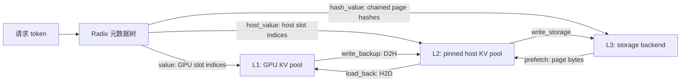

# HiCache 源码剖析：从零建立分层 KV Cache 心智模型

> **对应源码版本**：`main@f1c247edf997e932ad6fa35d479e98b41a18ce6e`<br>
> **目标读者**：不了解大模型推理、KV Cache、Radix Tree、CUDA 异步编程的初学者<br>
> **阅读目标**：能沿一个请求解释 HiCache 的完整生命周期，能独立定位命中下降、容量不足、读写失败和并发时序问题

本书只陈述上述固定 `main` 快照的实际行为。此前实验分支中的 L2 pure-buffer、流式 L3 -> L1 传输、native hash fallback 和自定义累计日志，不会被当作当前主分支已有功能；第 13 章只把其中有价值的思路标为设计/观测建议。切换源码提交后，应先重新运行附录一致性检查，再复核正文中的时序结论。

这不是一份参数手册，也不是把注释换成中文。它试图回答源码阅读时最容易混在一起的三个问题：

1. **数据在哪里？** 真正的 K/V 字节位于 GPU pool、host pool 或 L3；Radix 节点主要保存的是索引和状态。
2. **资源归谁？** 每段 GPU/host 索引都必须有明确的拥有者，异步操作期间还需要锁或引用计数保护。
3. **什么时候可用？** “已分配”“已排队”“DMA 已完成”“树上已发布”“L3 已持久化”是五个不同状态。

只要把这三件事分清，HiCache 的绝大多数复杂代码都会变得可追踪。

## 推荐阅读顺序

| 阶段 | 章节 | 读完应能回答 |
|---|---|---|
| 建立基础 | [00 阅读方法](00-reading-guide.md)、[01 基础概念](01-foundations.md) | KV Cache 为什么能复用？token、page、index 分别是什么？ |
| 看懂全貌 | [02 总体架构](02-architecture.md)、[03 启动与对象装配](03-startup-and-configuration.md) | L1/L2/L3、树、控制器、线程如何连接？ |
| 补齐数据底座 | [03a L1 与请求映射](03a-l1-memory-and-request-mapping.md)、[03b 状态数据契约](03b-state-and-data-contracts.md) | 请求行、KV slot、tree value、operation 字段分别代表什么？ |
| 看懂元数据 | [04 Radix Tree](04-radix-tree.md) | 一个共享前缀如何匹配、插入、分裂和加锁？ |
| 跟完请求 | [05 请求全生命周期](05-request-lifecycle.md)、[06 读路径](06-read-path.md)、[07 写路径](07-write-path.md) | 一个请求何时查 L3、何时回载、何时重算、何时写回？ |
| 理解正确性 | [08 回收与所有权](08-eviction-and-ownership.md)、[09 并发与同步](09-concurrency.md) | 为什么不能随便释放 L2？ACK、event、TP/PP 同步在保护什么？ |
| 深入数据面 | [10 L2 布局与内核](10-host-layout-and-kernels.md)、[11 L3 后端](11-storage-backends.md) | page-first 为什么有利于 L3？自研 L3 必须满足什么契约？ |
| 扩展与实战 | [12 Unified/混合模型](12-unified-and-hybrid.md)、[13 性能分析](13-performance.md)、[14 故障排查](14-debugging.md) | 高并发为什么掉命中？如何根据日志和状态判断瓶颈？ |
| 对照源码 | [15 函数地图](15-function-map.md)、[16 阅读练习](16-reading-labs.md)、[17 术语表](17-glossary.md)、[逐函数附录](appendix/README.md) | 从任一入口快速找到下游函数、状态和完整代码。 |

第一次阅读建议先完成 00 到 07（包括 03a/03b），不要一开始顺序阅读 1178 个函数。正文解释“为什么这样设计”，附录用于核对“代码具体怎么写”。

## 全书范围

本书将源码分成三圈：

### 核心必读

- `registry.py`、`kv_cache_builder.py`：创建入口与实现选择。
- `memory_pool.py`、`allocator/{base,token,paged,hisparse,swa,mamba}.py`、`mem_cache/common.py`：请求行、L1 物理 KV slots、普通/混合模型分配与结束提交。
- `base_prefix_cache.py`、`radix_cache.py`、`hiradix_cache.py`：公共契约、经典树结构和分层缓存状态机。
- `cache_controller.py`：数据搬运、CUDA stream/event、L3 工作线程。
- `pool_host/base.py`、`pool_host/mha.py`：L2 页槽与 MHA 数据布局。
- `hicache_storage.py`、`storage/backend_factory.py`：L3 接口、键语义与后端装配。
- `observability/metrics_collector.py` 与 `scheduler_components/output_streamer.py`：请求级 device/host/storage 命中来源、HiCache/Radix Prometheus 指标及其覆盖边界。
- `jit_kernel/hicache.py` 及两个 `.cuh`：真正执行 L1/L2 搬运的数据面。

### 扩展必读

- `unified_radix_cache.py`、`unified_cache_components/*.py`：SWA/Mamba 等组件化状态及各组件匹配、锁、淘汰和 HiCache transfer 策略。
- `hybrid_cache_controller.py`、`hybrid_pool_assembler.py`：多 pool 复合搬运和模型装配。
- `memory_pool_host.py`：MLA、Mamba、DSA、DeepSeek V4 等 host pool。
- Scheduler、PrefillAdder、Req、batch result processor、PD decode mixin 中与 HiCache 直接相关的入口。

### 后端实现边界

正文完整讲解 `HiCacheStorage` 契约、`HiCacheFile` 参考实现、工厂及控制器如何调用 L3。Mooncake、NIXL、HF3FS、AIBrix、EIC、SiMM、MORI 的第三方/特化实现不逐函数复制，因为它们是接口实现而不是 HiCache 核心状态机。阅读自研分布式内存 L3 时，应重点逐项对照 [11 L3 后端](11-storage-backends.md) 的契约清单。

## 一眼看懂三个层级



这里最重要的一句话是：**树不是数据本身，树是“token 前缀到各层数据位置”的目录。**

另一个必须提前知道的源码事实：`RadixKey.extra_key` 会隔离本地树，但当前 native page hash 不读取它。L3 的模型/rank/语义隔离还依赖 backend namespace；详见 [03b.10](03b-state-and-data-contracts.md#3b10-两套-key-namespace-不要混为一谈)。

## 文档与源码一致性

逐函数附录由脚本从当前源码 AST 生成，当前覆盖 1178 个 Python 函数、132 个类声明和三份完整 C++/CUDA/ROCm 文件。每个函数都包含：

- 完整代码和精确行号；
- 签名、用途和同步/异步形式；
- 对象状态读写；
- 直接调用和控制结构；
- 初学者容易忽略的生命周期提示。

类声明附录还列出基类、装饰器、类体字段；没有方法的数据类会保留完整声明。运行时在 `__init__` 写入的字段仍应结合各函数的“状态读写”阅读。

其中源码、行号、签名、调用和状态访问是机械提取结果；“作用”和“初学者注意”是用于导航的启发式摘要，关键路径做了人工覆盖，但不能代替正文或源码语义。尤其是 AST 把 `self.method` 也视为一次属性读取，这不表示它是业务状态字段。

检查附录是否仍与源码一致：

```bash
python3 docs/hicache_source_guide/tools/generate_function_appendix.py --check
```

更新附录：

```bash
python3 docs/hicache_source_guide/tools/generate_function_appendix.py
```

机器可读的覆盖结果位于 [appendix/coverage.json](appendix/coverage.json)。

## 阅读时统一使用的符号

| 符号 | 本书含义 |
|---|---|
| `L1` | GPU 上的 KV cache pool，延迟最低、容量最小。 |
| `L2` | CPU/host 上的预分配 KV pool，通常使用 pinned memory。 |
| `L3` | 文件、分布式内存或远端 KV 存储，容量最大。 |
| `key` | Radix 边上的 token 序列，不等于 L3 字符串 key。 |
| `value` | 某段 token 在 L1 中的槽位索引 tensor。 |
| `host_value` | 同一段 token 在 L2 中的槽位索引 tensor。 |
| `hash_value` | 每个 page 的链式 hash，用作 L3 内容地址。 |
| `page_size` | 缓存分配、hash 和 L3 I/O 的基本 token 粒度。 |
| `ACK` | 某批异步操作已经完成、调度线程可以提交状态的通知。 |
| “命中” | 必须带层级说明；L3 `exists` 命中不等于 L1 已可计算。 |

下一章：[如何阅读这套源码](00-reading-guide.md)。
