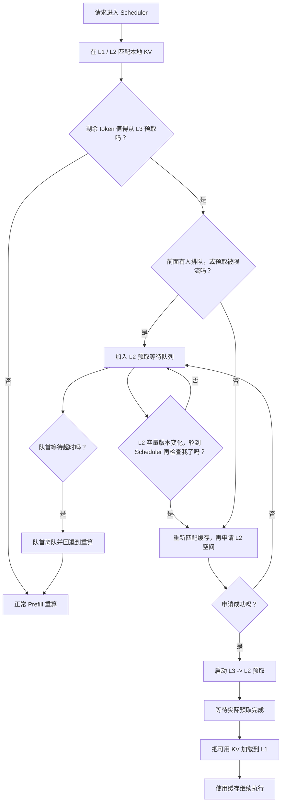
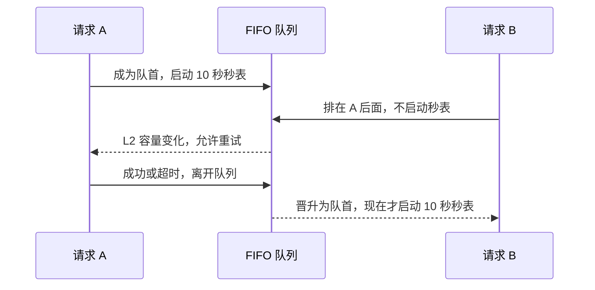

这篇文档不要求你先懂缓存、并发或分布式系统。我们先用一个生活中的例子理解问题，再回到代码，一步一步看这次改动做了什么。

## 先记住四个东西

可以把 HiCache 想成一间需要不断查资料的教室：

| HiCache 名称 | 在哪里 | 可以想成 | 特点 |
| --- | --- | --- | --- |
| L1 | GPU 显存 | 你的课桌 | 最快，但是空间最小 |
| L2 | CPU 内存 | 教室里的中转桌 | 比 L1 大，负责暂存和搬运 |
| L3 | 分布式缓存 | 很大的资料仓库 | 空间最大，但是资料要经过 L2 才能搬到 L1 |
| 重算 | GPU 重新做 Prefill | 不去仓库，自己重新抄一份资料 | 一定能继续执行，但是浪费算力 |

模型收到一串 token 后，会先看 L1 和 L2 有没有已经算好的 KV Cache。缺少的那一段如果在 L3 中，HiCache 就尝试执行：

```text
L3 仓库 -> L2 中转桌 -> L1 课桌 -> 模型继续计算
```

这里有一个关键限制：**当前实现必须先在 L2 找到一块可用空间，才能启动一次 L3 预取。**

高并发时，很多请求同时借用 L2。L2 可能只是暂时没有空间，并不代表 L3 中没有缓存。旧路径遇到这种情况会放弃本次 L3 预取，请求随后重新计算，所以 cache-hit 会明显下降。

## 这次改动只做了一件核心事情

> L2 暂时忙时，不要马上放弃 L3 缓存；先排队，等 L2 有空间后再试。

等待者按进入顺序保存在一个 FIFO 队列中：

```text
队首                                               队尾
请求 A -> 请求 B -> 请求 C -> 请求 D
```

请求 A 是队首，也是唯一会计算超时的请求。L2 容量发生变化后，已有等待者会按照 Scheduler 的扫描顺序各获得一次重试机会；新来的请求不能越过这批老等待者。这样做有三个好处：

1. 不会让刚来的请求插队。
2. 不会让所有等待请求在每个调度循环中反复抢 L2。
3. L2 空间刚释放时，等待请求可以重新尝试预取，而不是直接重算。

这个功能默认关闭。关闭时，代码仍走 SGLang 原来的预取路径。

## 一个请求从进入到结束

下面是开启队列后的完整流程：



### 第 1 步：Scheduler 发起预取

入口在：

```text
python/sglang/srt/managers/scheduler.py
Scheduler._prefetch_kvcache()
```

原来它直接调用 `tree_cache.prefetch_from_storage()`。现在它调用：

```text
prefetch_from_storage_with_admission()
```

这个包装函数很薄：

- 队列未开启：直接调用原函数，行为不变。
- 队列已开启：交给 `L2PrefetchAdmission.prefetch()` 判断是立即预取还是排队。

因此，这次改动没有重写原有 L3 后端，也没有修改 KV 数据的读写格式。

### 第 2 步：判断是否需要排队

`L2PrefetchAdmission.prefetch()` 主要检查三道门：

1. **FIFO 门**：前面已经有人排队时，新请求不能插队。
2. **限流门**：正在预取的 token 已达到 `prefetch_capacity_limit` 阈值时，先等待。
3. **真实分配门**：向 L2 内存池申请空间；申请失败时，尝试 L2 淘汰和较小的部分分配。

只要暂时过不了这些门，请求就通过 `enqueue(req_id)` 留在队列里。

### 第 3 步：等待时不空转

请求排队后仍留在 Scheduler 的等待队列中，但不会在每一轮都重新申请 L2。

代码用一个整数 `capacity_generation` 表示“L2 容量状态是第几版”。可以把它想成贴在中转桌上的号码牌：

```text
号码还是 7：桌面没有发生新变化，不必再问一次。
号码从 7 变成 8：可能有空间了，队首可以再试一次。
```

每个等待请求会记住自己上次失败时看到的号码。`can_retry()` 只有在号码变化后才返回 `True`。这避免了 Scheduler 高频循环时不断执行内存申请、淘汰和 TP 同步。

容量号码会在这些事件后推进：

- L2 节点被淘汰，释放了 host memory。
- 一次 L3 预取完成，预取占用下降。
- 正在进行的预取被终止或请求被取消。
- 某个等待请求成功、取消或超时离队，剩余请求需要获得新的尝试机会。

一次容量版本变化会让已有等待者在 Scheduler 的原有顺序中各尝试至多一次。它们如果再次失败，会记住这个新版本，等下一次容量变化再试。FIFO 队首在这里主要负责公平超时；真正的重试顺序由 Scheduler 的 `waiting_queue` 扫描顺序决定。

### 重试和超时是两套不同的规则

这是最容易看混的地方：

| 问题 | 由谁回答 | 规则 |
| --- | --- | --- |
| 现在能不能再申请一次 L2？ | `capacity_generation` | 容量版本变化后，已有等待者按 Scheduler 顺序各试一次 |
| 现在谁可以因为等太久而放弃？ | `head_since` | 只有 FIFO 队首会计算超时 |

把它们分开，是为了同时照顾吞吐和公平：

- 只让队首重试，可能会被一个暂时放不下的大请求挡住。
- 让所有请求每轮都重试，会产生大量无用的申请、淘汰和同步。
- 让等待批次只在容量变化后重试，同时只让队首计时，可以避免这两个问题。

### 第 4 步：重试前必须重新匹配

等待期间，HiRadixTree 可能已经变化。例如，别的请求可能插入了同样的前缀，旧节点也可能已经被淘汰。

所以 Scheduler 不会继续使用排队前保存的节点，而是重新调用 `_prefetch_kvcache()`：

```python
# Waiting does not pin a radix node, so rematch before retry.
if not self._prefetch_kvcache(req):
    l2_admission.cancel(req.rid)
```

这一步非常重要。它避免了长期持有 RadixTree 节点，也避免了拿着过期节点继续预取。

### 第 5 步：申请 L2

`L2PrefetchAdmission._allocate()` 按以下顺序工作：

1. 先申请完整的 `requested_tokens`。
2. 失败后调用 `cache.evict_host()`，尝试淘汰 L2 数据，再申请一次。
3. 仍失败时，查看当前可用空间；如果至少能容纳 `prefetch_threshold`，就申请一段较小空间。
4. 将数量按 `page_size` 对齐。
5. TP 多卡通过 `all_reduce(MIN)` 取所有 rank 都能提供的最小数量。

最后一点保证了各个 TP rank 使用相同长度。否则一张卡预取 4096 个 token，另一张卡只预取 2048 个 token，后续状态就会不一致。

### 第 6 步：启动真正的 L3 预取

L2 分配成功后，代码才调用原有的：

```text
cache.cache_controller.prefetch(...)
```

从这里开始，数据读取、完成检查、写入 HiRadixTree、L2 到 L1 的加载，仍然使用 SGLang 原来的实现。

请求成功启动预取后会立刻从准入队列删除。这里的“离队”不表示 L3 数据已经读完，只表示它已经拿到 L2 座位并进入原有预取流程。

## 为什么旧版 10 秒超时会让 cache-hit 更低

这个问题的根源不是“10 秒太短”这么简单，而是**秒表从什么时候开始计时**。

### 有问题的计时方式

旧实现让每个请求一入队就启动自己的 10 秒秒表：

| 时间 | A | B | C |
| --- | --- | --- | --- |
| 0 秒 | 入队并开始计时 |  |  |
| 1 秒 | 等待 | 入队并开始计时 |  |
| 2 秒 | 等待 | 等待 | 入队并开始计时 |
| 10 秒 | A 超时离队 | B 已经用了 9 秒 | C 已经用了 8 秒 |
| 11 秒 |  | B 刚成为队首就超时 | C 已经用了 9 秒 |
| 12 秒 |  |  | C 刚成为队首就超时 |

B 和 C 的大部分超时时间都花在“站在别人后面”。即使容量变化时它们可能得到过零散的重试机会，它们也没有获得一段从自己成为队首才开始计算的完整等待窗口。

当请求持续进入时，这会形成连续超时：队首一离开，后面的请求很快也过期。它们不再尝试 L3，直接回退到重算，所以开启队列后的 cache-hit 甚至可能低于不开队列。

例如，256 个请求以每秒 16 个的速率进入，仅把请求送入系统就需要约 16 秒。若所有请求入队时就启动 10 秒秒表，后半段队列很容易在轮到自己之前耗完预算。

### 现在的计时方式

新实现规定：

> 只有队首拥有秒表。后面的请求先不计时，成为队首时才拿到一块完整的超时预算。

| 时间 | A | B | C |
| --- | --- | --- | --- |
| 0 秒 | 成为队首，开始计时 | 排队，不计时 | 排队，不计时 |
| 10 秒 | A 超时离队 | 成为队首，开始计时 | 排队，不计时 |
| 20 秒 |  | B 超时离队 | 成为队首，开始计时 |
| 30 秒 |  |  | C 才会超时 |

如果 A 在第 3 秒成功拿到 L2，B 就从第 3 秒开始计时，不必等到第 10 秒。



所以 `l2_prefetch_wait_timeout=10` 的准确含义是：

> 一个请求成为队首后，最多允许 L2 连续 10 秒都无法接纳它。

它**不是**请求在整个队列中的最长停留时间。一个请求总共排队多久，还取决于前面有多少请求。

## 队列必须一直遵守的五条规则

阅读代码时，可以用下面五条规则检查实现是否正确：

1. 队列为空时，没有请求在计时。
2. 队列非空时，只有队首的 `head_since` 有时间值。
3. 所有队首后面的请求，其 `head_since` 都是 `None`。
4. 队首申请失败并重新入队时，不能重置它的秒表。
5. 队首成功、取消或超时离开后，下一位立即成为队首并开始新的秒表。

这五条规则集中在 `_WaitingPrefetch`、`enqueue()`、`cancel()`、`oldest_expired()`、`expire_oldest()` 和 `_activate_oldest()` 中。

## 逐个认识新增模块中的函数

新增代码主要位于：

```text
python/sglang/srt/mem_cache/l2_prefetch_admission.py
```

### 配置

| 函数或类型 | 作用 |
| --- | --- |
| `L2PrefetchAdmissionConfig` | 保存开关、预取容量比例和队首等待超时 |
| `pop_from()` | 从 L3 extra config 中取出三个配置，并严格校验类型和范围 |
| `apply_capacity_limit()` | 用 `L2 总 token 容量 × capacity_ratio` 算出暂停接纳新预取的阈值 |

### 队列状态

| 函数或类型 | 作用 |
| --- | --- |
| `_WaitingPrefetch` | 保存一个等待请求的队首开始时间，以及它上次失败时看到的容量版本 |
| `is_waiting()` | 查询某个请求是否还在队列中 |
| `should_wait_behind_existing()` | 判断新请求是否必须排到已有请求后面 |
| `enqueue()` | 新请求排到队尾；只有空队列中的第一个请求立即启动秒表 |
| `can_retry()` | 只有容量版本变化后，才允许这个等待请求再次尝试一次 |
| `cancel()` | 删除成功、取消或不再需要预取的请求；若删除的是队首，就启动下一位的秒表 |
| `clear()` | reset、detach 或重新配置时清空所有等待状态 |

### 超时与容量通知

| 函数 | 作用 |
| --- | --- |
| `capacity_changed()` | 记录 L2 容量可能变化，等待下一次多 rank 同步 |
| `_advance_capacity_generation()` | 推进容量版本，让等待请求获得一次重试机会 |
| `oldest_expired()` | 只检查队首是否超时，不检查后面的请求 |
| `expire_oldest()` | 删除超时队首，返回请求 ID 和实际队首等待时间，再启动下一位 |
| `_activate_oldest()` | 只在队首还没有秒表时启动它；重复调用不会重置时间 |
| `drain_storage_control_queues()` | 将容量事件、超时判断和原有控制队列放进一次 TP 同步中处理 |

### 预取准入

| 函数 | 作用 |
| --- | --- |
| `prefetch()` | 准入主流程：检查 FIFO、限流、分配 L2，成功后调用原有预取 |
| `_prefetch_rate_limited()` | 判断当前在途预取 token 是否达到上限 |
| `_blocked_on_any_rank()` | 任意 TP rank 被阻塞时，所有 rank 一起排队 |
| `_allocate()` | 尝试完整分配、淘汰后重试、部分分配，并统一各 rank 的长度 |
| `prefetch_from_storage_with_admission()` | 低耦合入口；开关关闭时直接转发到原路径 |
| `get_l2_prefetch_admission()` | 只对已开启且受支持的 cache 返回队列对象 |
| `log_l2_prefetch_admission_status()` | 在启动或动态 attach 时打印最终生效状态 |

## 其他文件改了什么

### `scheduler.py`

改动很小，只有两个职责：

1. 把原来的预取调用换成可选的准入包装函数。
2. 扫描等待请求时，只让看到新容量版本的请求重新匹配并重试。

### `hiradix_cache.py`

它负责把队列接到 HiCache 生命周期中：

- 启动、动态 attach 时创建或配置队列。
- reset、detach、abort 时清理等待请求。
- L2 淘汰、预取完成、预取终止时发送容量变化通知。
- 周期性检查队首超时。
- 通过 TP 同步保证各 rank 同进同退。

### `registry.py`

只负责打印一条启动日志，让使用者知道当前 cache 实现是否支持队列、配置是否开启、功能是否真正生效。

### 单元测试

测试文件位于：

```text
test/registered/unit/mem_cache/test_l2_prefetch_admission.py
```

重点覆盖：

- 默认关闭时保持原路径。
- 配置值和非法输入。
- 新请求不插队、等待批次按 Scheduler 顺序重试，以及容量版本重试。
- L2 完整分配、淘汰后分配和部分分配。
- TP rank 阻塞与分配长度一致。
- 异常时释放 L2 空间和节点保护。
- reset、detach、abort 时清理队列。
- 后排请求晋升后才开始超时。
- 取消队首会启动下一位，但取消后排请求不会重置队首。
- 一次控制循环最多让一个队首超时，不会批量超时。

## 三个配置怎么理解

示例：

```bash
--hicache-storage-backend-extra-config \
'{"enable_l2_prefetch_queue":true,"prefetch_capacity_ratio":0.5,"l2_prefetch_wait_timeout":10}'
```

| 配置 | 默认值 | 通俗解释 |
| --- | --- | --- |
| `enable_l2_prefetch_queue` | `false` | 是否开启这条等待路径 |
| `prefetch_capacity_ratio` | `0.5` | 用多少比例的 L2 token 容量作为“暂停接纳新预取”的阈值 |
| `l2_prefetch_wait_timeout` | `30` 秒 | 每个请求成为队首后，连续等不到 L2 的最大时间 |

`prefetch_capacity_ratio=0.5` 不表示切出一块固定、不能借用的 L2 区域。它只是计算 `prefetch_capacity_limit`。当已有在途预取 token 数达到这个阈值时，后续预取先排队。因为判断发生在新操作启动之前，最后一个已获准的操作可能让实际占用略微超过阈值。

启动时应看到类似日志：

```text
HiCache L2 prefetch queue: cache_impl=HiRadixCache supported=true
enabled=true active=true capacity_ratio=0.500 wait_timeout_s=10.00
capacity_limit_tokens=...
```

队首超时时，DEBUG 日志为：

```text
HiCache L2 prefetch head wait timed out for request ... after 10.00s;
falling back to recomputation
```

日志中特意写了 `head wait`，表示这是队首等待时间，不是整个排队时间。

## 这次改动没有做什么

为了保持低耦合和方便后续升级，这次改动没有：

- 修改任何 L3 存储后端的实现。
- 修改 L3 数据格式、哈希算法或实际读写协议。
- 修改 L2 的基础内存池。
- 修改 HiRadixTree 的节点结构。
- 修改 L2 到 L1 的数据搬运实现。
- 修改 KV 写回 L3 的流程。
- 增加专用 L2 buffer 或改变 L2 淘汰规则。
- 在功能关闭时改变原有预取行为。

因此，这个队列解决的是“L2 暂时忙时过早放弃预取”的问题，而不是让 L3 本身读得更快。

## 容错时做了什么

预取链路涉及内存、RadixTree 节点和多 rank 状态，异常清理不能少：

- 本地 L2 已分配、但 TP 分配长度同步失败：释放已经分到的 host indices。
- 启动实际预取抛异常：释放 L2 空间、解除 host 节点保护、移出队列，再继续抛出异常。
- 请求被 abort：无论它还在排队还是已经预取，都清理对应状态。
- storage detach 或 cache reset：清空队列，避免旧请求状态污染下一轮。
- 任意 TP rank 无法准入：通过 `all_reduce(MAX)` 让所有 rank 一起等待。
- 各 rank 可分配长度不同：通过 `all_reduce(MIN)` 统一为共同可用长度。

## `wait_complete` 和这个队列是什么关系

它们管的是两个不同阶段：

```text
准入队列                         wait_complete
等待拿到 L2 空间 -> 启动预取 -> 等待 L3 数据读取完成
```

- 准入队列解决“能不能启动预取”。
- `wait_complete` 解决“预取启动后，要等到什么时候再计算”。

所以使用 `wait_complete` 并不能代替准入队列。如果 L2 分配失败，预取根本没有启动，`wait_complete` 也没有可以等待的 operation。

## 应该怎样阅读代码

建议按下面顺序阅读，不要一上来从 400 多行新增文件的第一行读到最后一行：

1. 先看 `scheduler.py` 中 `_prefetch_kvcache()`，找到新入口。
2. 看 `prefetch_from_storage_with_admission()`，理解开关关闭时为什么不改变旧路径。
3. 看 `L2PrefetchAdmission.prefetch()`，掌握排队、分配和启动预取的主流程。
4. 看 Scheduler 中 `is_waiting()`、`can_retry()` 那一小段，理解请求如何被重新调度。
5. 看 `enqueue()`、`cancel()` 和 `_activate_oldest()`，理解 FIFO 和秒表。
6. 看 `capacity_changed()` 与 `drain_storage_control_queues()`，理解什么时候允许重试。
7. 最后看 `_allocate()` 和测试，确认多 rank、部分分配和异常清理。

读每个函数时都问自己三个问题：

1. 请求现在是“排队”“正在预取”还是“已经回退重算”？
2. L2 空间由谁持有，失败时由谁释放？
3. 队首变化后，下一位的秒表有没有且只启动一次？

只要这三个问题一直有明确答案，整条链路就不会乱。
